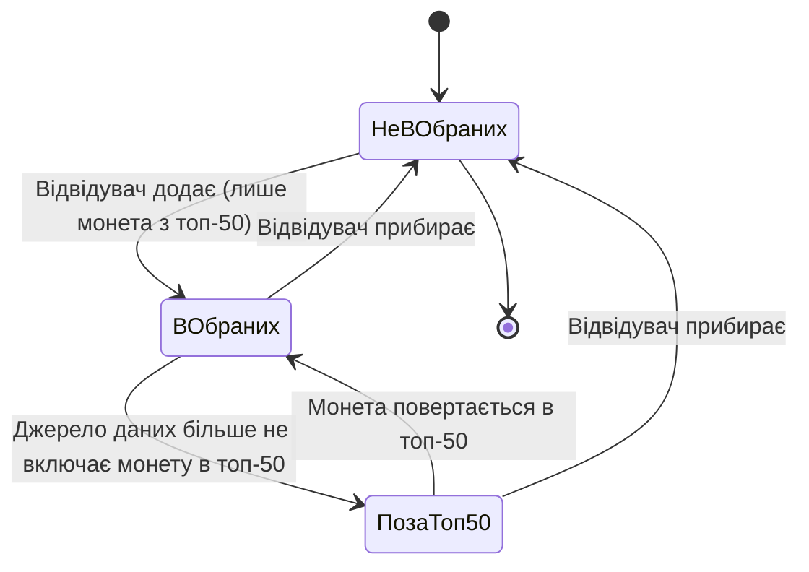
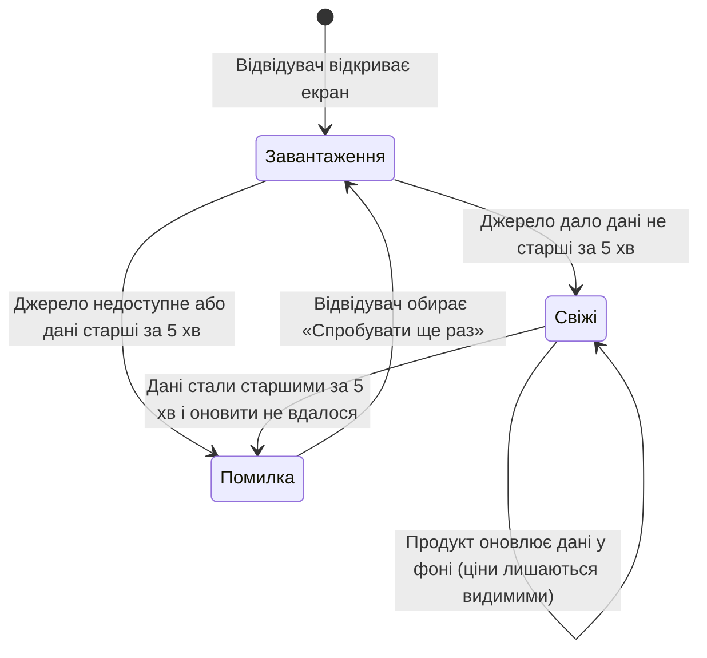
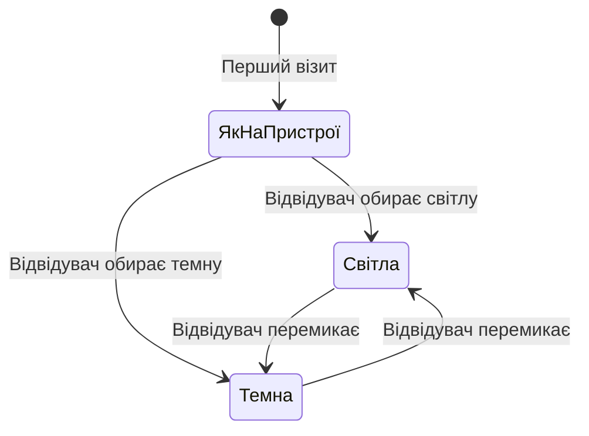

# Вимоги: Крипто-Радар

- **Етап:** Stage 2: Вимоги: User Stories та Gherkin-критерії
- **Дата:** 2026-11-02
- **Вхід:** `.agentic/specs/01-product-brief.md` (схвалено 2026-11-02, коміт `04c6271`), `.agentic/reports/01-discovery-report.md`, розділ 4 `.agentic/pipeline-state.md`.
- **Рішення власника на етапі 2 (2026-11-02):** топ-50 за капіталізацією; сортування за замовчуванням за ціною від найдорожчої; пошук за назвою (як у джерелі даних) або тікером, без українського написання назв; список показує 25 монет, «показати більше» додає 25; підказки до 6 термінів; обрана монета, що вибула з топ-50, лишається з позначкою; при збої або застарілих даних — лише повідомлення про помилку, без цін; погоджено 5 правил (пошук, сортування, обрані, тема, монета поза топ-50).
- **Ілюстрація JTBD-1 (відкрите питання №1 брифу, відповідь власника 2026-11-02):** «сьогодні на Мінфін заходив: чи піднявся біткоїн на тлі падіння акцій компаній з ШІ-пулу, які втратили на тижні». Власник хотів побачити зміну ціни конкретної монети за тиждень — це US-1, US-2 і US-4.

---

## 1. Огляд і трасування на бриф

| G-N | Можливість MVP (бриф §10) | US-N |
| :--- | :--- | :--- |
| G-1 | 1. Список топ-50 з ціною, зміною за 7 днів, капіталізацією; «показати більше» | US-1 |
| G-1 | 2. Сортування за ціною (за замовчуванням), зміною за 7 днів, капіталізацією | US-2 |
| G-1 | 3. Пошук монети | US-3 |
| G-1 | 4. Сторінка монети з графіком за 7 днів | US-4 |
| G-1 | 5. Обрані без акаунта, на пристрої | US-5, US-6 |
| G-3 | 6. Підказки до термінів | US-7 |
| G-1 | 7. Українська, без реклами, дисклеймер, джерело даних | US-9 |
| G-1 | Свіжість цін ≤ 5 хв, guardrail M-5 (бриф §9, §13) | US-8 |
| G-1 | 8. Світла й темна тема (найнижчий пріоритет) | US-10 |

Кожна можливість MVP працює також на G-2 (власник проходить конвеєр). Жоден пункт «Не входить у MVP» (бриф §11) не став історією Must; вони перелічені як Won't у розділі 7.

## 2. Глосарій

| Термін | Визначення | Синоніми, яких уникаємо | Приклад |
| :--- | :--- | :--- | :--- |
| **Відвідувач** | Людина, яка відкрила Крипто-Радар у браузері телефона чи ПК; входу й реєстрації немає | користувач, клієнт, гість | Знайомий власника відкрив посилання |
| **Монета** | Криптовалюта зі списку джерела даних | токен, актив, коїн, криптовалюта (у кроках) | Bitcoin |
| **Назва монети** | Повна назва монети так, як її подає джерело даних | ім'я | «Bitcoin» |
| **Тікер** | Коротке позначення монети з 2–6 латинських літер або цифр, як у джерелі даних | символ, код | «BTC» |
| **Капіталізація** | Ринкова вартість усіх монет одного виду в обігу, у доларах США, за даними джерела | ринкова вартість, market cap | $1,2 трлн |
| **Місце в рейтингу** | Порядковий номер монети від 1 до 50 у топ-50 за капіталізацією | ранг, позиція | Bitcoin — місце 1 |
| **Топ-50** | 50 монет із найбільшою капіталізацією за даними джерела на момент отримання даних | топ, рейтинг, список монет | Місця 1–50 |
| **Список монет** | Головний екран: монети топ-50 з місцем у рейтингу, ціною, зміною за 7 днів і капіталізацією | таблиця, головна, ринок | — |
| **Ціна** | Поточна ціна однієї монети в доларах США (USD) за даними джерела | курс, вартість | $67 250,10 |
| **Зміна за 7 днів** | Зміна ціни монети у відсотках відносно ціни 7 днів тому; додатна — зростання, від'ємна — падіння | тижнева динаміка, приріст | +4,2 % |
| **Графік за 7 днів** | Лінійний графік ціни монети за останні 7 днів | чарт, діаграма | — |
| **Сторінка монети** | Екран однієї монети з її даними й графіком за 7 днів | картка, деталі | Сторінка Bitcoin |
| **Стейблкоїн** | Монета, ціна якої прив'язана до звичайної валюти, зазвичай до долара США | стабільна монета | USDT |
| **Волатильність** | Наскільки сильно й часто змінюється ціна монети за період | мінливість, коливання | — |
| **Підказка** | Коротке пояснення терміна (одне–два речення українською), яке відвідувач відкриває поруч із терміном | тултіп, довідка, пояснення | Підказка до «Капіталізація» |
| **Обрані** | Монети, які відвідувач позначив, щоб швидко до них повертатися; зберігаються лише на його пристрої | вибране, улюблені, вотчліст, список спостереження | — |
| **Пристрій** | Браузер на конкретному телефоні чи ПК, з якого відвідувач відкриває Крипто-Радар | девайс | Телефон відвідувача |
| **Пошуковий запит** | Текст, який відвідувач вводить, щоб знайти монету за назвою або тікером | фільтр | «btc» |
| **Джерело даних** | Зовнішній публічний сервіс курсів криптовалют, з якого Крипто-Радар отримує дані (вибір — етап 3) | API, провайдер, постачальник | — |
| **Свіжість даних** | Час, що минув від моменту, на який джерело даних подало ціни; дані **свіжі**, якщо минуло не більше 5 хвилин, і **застарілі**, якщо більше | актуальність | Дані 3-хвилинної давності — свіжі |
| **Повідомлення про помилку даних** | Повідомлення, що дані зараз недоступні, з дією «Спробувати ще раз»; цін при цьому не видно | помилка, збій | — |
| **Дисклеймер** | Текст «Інформація не є інвестиційною порадою» | застереження | — |
| **Тема** | Колірна схема інтерфейсу: світла або темна | режим, скін | — |

## 3. Ролі й матриця дозволів

**Ролі:**

- **Відвідувач** — єдина роль. Входу, реєстрації й акаунтів немає (бриф §11).
- **Адміністратора немає.** Дані про монети приходять із джерела даних, контент у продукті ніхто не редагує.

| Дія | Відвідувач |
| :--- | :--- |
| Переглядати список монет (топ-50) | так |
| Догружати список кнопкою «показати більше» | так |
| Сортувати список монет | так |
| Шукати монету за назвою або тікером | так |
| Відкривати сторінку монети з топ-50 | так |
| Переглядати ціну, графік чи дані монети поза топ-50 | ні (бачить повідомлення «Монета зараз поза топ-50») |
| Додавати монету з топ-50 в обрані | лише своє (обрані на своєму пристрої) |
| Додавати в обрані монету поза топ-50 | ні |
| Прибирати монету з обраних | лише своє (обрані на своєму пристрої) |
| Переглядати обрані | лише своє (обрані на своєму пристрої) |
| Відкривати підказку до терміна | так |
| Перемикати тему | так (вибір на своєму пристрої) |
| Купувати, продавати, обмінювати монети | ні (немає в продукті, бриф §11) |
| **Дія над чужим об'єктом** (переглянути чи змінити обрані іншого відвідувача) | **не застосовно:** обрані зберігаються лише на пристрої відвідувача й нікуди не передаються; спільних об'єктів, акаунтів і ідентифікаторів відвідувачів немає, тож чужий об'єкт неможливо адресувати |

## 4. Життєвий цикл об'єктів

### 4.1. Монета в обраних (на пристрої відвідувача)



- **В обраних:** показується з місцем у рейтингу, ціною, зміною за 7 днів і капіталізацією.
- **Поза топ-50:** лишається в обраних з позначкою «Зараз поза топ-50», без ціни й інших даних.
- Додати монету поза топ-50 (перехід НеВОбраних → ПозаТоп50) не можна.

### 4.2. Дані про курси (на кожному екрані з цінами)



- У стані **Помилка** не показується жодна ціна, зміна, капіталізація чи графік (рішення власника 2026-11-02, guardrail M-5).
- Обрані у стані Помилка не втрачаються.

### 4.3. Тема (на пристрої відвідувача)



Вибір теми запам'ятовується на пристрої.

## 5. User Stories і критерії приймання

### US-1: Перегляд списку топ-50

Як відвідувач, я хочу раз на тиждень відкрити список найбільших монет з ціною, зміною за 7 днів і капіталізацією, щоб за хвилину зрозуміти, куди рухається ринок.

Ціль: G-1 · Пріоритет: Must · Value/Cost: 5/2 · Залежить від: —

**Бізнес-правила:**

1. Список монет містить лише топ-50 за капіталізацією (рішення власника 2026-11-02, відкрите питання №9 брифу).
2. Для кожної монети видно: місце в рейтингу, назву, тікер, ціну в USD, зміну за 7 днів, капіталізацію.
3. Зміна за 7 днів показується з точністю до 0,1 % (округлення до найближчого, половина — від нуля). Знак ставиться після округлення: «+» для зростання, «−» для падіння; якщо округлене значення 0,0 %, знака немає й напрям — «без змін».
4. Спершу видно 25 монет. Кнопка «Показати більше» додає наступні 25. Коли видно всі 50 монет, кнопку «Показати більше» не видно (рішення власника 2026-11-02, відкрите питання №3 брифу).
5. Порожній стан: окремого порожнього стану немає. Список топ-50 порожній лише тоді, коли джерело даних не дало даних, і цей випадок покриває US-8.
6. Відкриття без входу й реєстрації.
7. Чужий об'єкт: не застосовно (список спільний для всіх, відвідувач його не змінює).

INVEST: I ✓ · N ✓ · V ✓ · E ✓ · S ✓ · T ✓

```gherkin
# language: uk
Функціонал: Перегляд списку топ-50
  Як відвідувач
  Я хочу раз на тиждень відкрити список найбільших монет
  Щоб за хвилину зрозуміти, куди рухається ринок

  @US-1 @AC-1.1
  Сценарій: Відвідувач бачить дані монет у списку
    Дано джерело даних має свіжі дані топ-50
    І монета "Bitcoin" з тікером "BTC" має місце в рейтингу 1, ціну "$67 250,10", зміну за 7 днів "+4,2 %" і капіталізацію "$1,32 трлн"
    Коли відвідувач відкриває список монет
    Тоді відвідувач бачить монету "Bitcoin" з тікером "BTC", місцем у рейтингу 1, ціною "$67 250,10", зміною за 7 днів "+4,2 %" і капіталізацією "$1,32 трлн"

  @US-1 @AC-1.2
  Сценарій: Список відкривається без входу й реєстрації
    Дано відвідувач ще ніколи не відкривав Крипто-Радар
    Коли відвідувач відкриває список монет
    Тоді відвідувач бачить список монет
    Але відвідувачу не пропонують увійти чи зареєструватися

  @US-1 @AC-1.3
  Структура сценарію: Кнопка «Показати більше» в межах топ-50
    Дано джерело даних має свіжі дані топ-50
    І відвідувач відкрив список монет
    Коли відвідувач обирає «Показати більше» <натискань> раз
    Тоді відвідувач бачить <видно> монет
    І відвідувач <кнопка> кнопку «Показати більше»

    Приклади:
      | натискань | видно | кнопка   |
      | 0         | 25    | бачить   |
      | 1         | 50    | не бачить |

  @US-1 @AC-1.4
  Структура сценарію: До списку потрапляють лише монети топ-50
    Дано джерело даних має свіжі дані про монету "<монета>" з місцем за капіталізацією <місце>
    Коли відвідувач відкриває список монет і обирає «Показати більше»
    Тоді монета "<монета>" <результат>

    Приклади:
      | монета    | місце | результат                   |
      | Bitcoin   | 1     | є в списку на місці 1       |
      | Монета-49 | 49    | є в списку на місці 49      |
      | Монета-50 | 50    | є в списку на місці 50      |
      | Монета-51 | 51    | відсутня в списку           |

  @US-1 @AC-1.5
  Структура сценарію: Знак зміни за 7 днів
    Дано монета "Bitcoin" має зміну за 7 днів <зміна>
    Коли відвідувач відкриває список монет
    Тоді відвідувач бачить для монети "Bitcoin" зміну за 7 днів "<показ>" як <напрям>

    Приклади:
      | зміна  | показ    | напрям     |
      | 4,2    | +4,2 %   | зростання  |
      | 0,06   | +0,1 %   | зростання  |
      | 0,05   | +0,1 %   | зростання  |
      | 0,04   | 0,0 %    | без змін   |
      | 0      | 0,0 %    | без змін   |
      | -0,04  | 0,0 %    | без змін   |
      | -0,05  | −0,1 %   | падіння    |
      | -0,06  | −0,1 %   | падіння    |
      | -3,7   | −3,7 %   | падіння    |
```

### US-2: Сортування списку

Як відвідувач, я хочу впорядкувати список за ціною, зміною за 7 днів або капіталізацією, щоб швидко побачити найдорожчі монети, лідерів зростання чи падіння й найбільші монети.

Ціль: G-1 · Пріоритет: Must · Value/Cost: 4/2 · Залежить від: US-1

**Бізнес-правила:**

1. За замовчуванням список упорядковано за ціною від найдорожчої монети (рішення власника 2026-11-02, відкрите питання №2 брифу).
2. Доступні впорядкування: «Ціна: від найдорожчої», «Зміна за 7 днів: найбільше зростання», «Зміна за 7 днів: найбільше падіння», «Капіталізація: від найбільшої».
3. Сортування впорядковує всі 50 монет топ-50, а не лише видимі. Після зміни сортування знову видно перші 25 монет (погоджене правило 2).
4. Монети з однаковим значенням упорядковуються за місцем у рейтингу.
5. Сортування поєднується з пошуком: результати пошуку впорядковані за обраним сортуванням.
6. Під час нового візиту сортування повертається до типового (за ціною від найдорожчої).
7. Граничні значення: числових меж немає, крім 50 монет (покриває US-1, AC-1.3, AC-1.4). Рівні значення — AC-2.4.
8. Чужий об'єкт: не застосовно (сортування не змінює спільних даних).
9. Негативний сценарій: під час помилки даних сортувати нічого, цін не видно й сортування недоступне — AC-2.6.
10. Порожній стан: якщо пошук не дав збігів, зміна сортування лишає повідомлення «Нічого не знайдено» — AC-2.7. Пошук і сортування разом — AC-2.8.

INVEST: I ✓ (на даних US-1) · N ✓ · V ✓ · E ✓ · S ✓ · T ✓

```gherkin
# language: uk
Функціонал: Сортування списку
  Як відвідувач
  Я хочу впорядкувати список за ціною, зміною за 7 днів або капіталізацією
  Щоб швидко побачити найдорожчі монети, лідерів зростання чи падіння й найбільші монети

  Передумова:
    Дано джерело даних має свіжі дані топ-50
    І монета "Bitcoin" має ціну "$67 250,10", зміну за 7 днів "+4,2 %" і місце в рейтингу 1
    І монета "Ethereum" має ціну "$3 120,00", зміну за 7 днів "−6,1 %" і місце в рейтингу 2
    І монета "Solana" має ціну "$150,40", зміну за 7 днів "+12,8 %" і місце в рейтингу 5

  @US-2 @AC-2.1
  Сценарій: Типове сортування за ціною від найдорожчої
    Коли відвідувач відкриває список монет
    Тоді список упорядковано "Ціна: від найдорожчої"
    І монета "Bitcoin" стоїть вище за "Ethereum", а "Ethereum" вище за "Solana"

  @US-2 @AC-2.2
  Структура сценарію: Відвідувач змінює сортування
    Дано відвідувач відкрив список монет
    Коли відвідувач обирає сортування "<сортування>"
    Тоді серед монет "Bitcoin", "Ethereum" і "Solana" першою стоїть "<перша>", а останньою "<остання>"

    Приклади:
      | сортування                         | перша    | остання  |
      | Зміна за 7 днів: найбільше зростання | Solana   | Ethereum |
      | Зміна за 7 днів: найбільше падіння   | Ethereum | Solana   |
      | Капіталізація: від найбільшої        | Bitcoin  | Solana   |

  @US-2 @AC-2.3
  Сценарій: Сортування охоплює весь топ-50 і повертає до перших 25
    Дано монета з найбільшим зростанням за 7 днів має місце в рейтингу 48
    І відвідувач відкрив список монет і обрав «Показати більше»
    Коли відвідувач обирає сортування "Зміна за 7 днів: найбільше зростання"
    Тоді монета з місцем у рейтингу 48 стоїть першою
    І відвідувач бачить 25 монет

  @US-2 @AC-2.4
  Сценарій: Монети з однаковою зміною впорядковані за місцем у рейтингу
    Дано монета "Tether" з місцем у рейтингу 3 має зміну за 7 днів "0,0 %"
    І монета "USD Coin" з місцем у рейтингу 7 має зміну за 7 днів "0,0 %"
    Коли відвідувач обирає сортування "Зміна за 7 днів: найбільше зростання"
    Тоді монета "Tether" стоїть вище за "USD Coin"

  @US-2 @AC-2.5
  Сценарій: Новий візит повертає типове сортування
    Дано минулого візиту відвідувач обрав сортування "Капіталізація: від найбільшої"
    Коли відвідувач знову відкриває список монет
    Тоді список упорядковано "Ціна: від найдорожчої"

  @US-2 @AC-2.6
  Сценарій: Сортування недоступне під час помилки даних
    Дано джерело даних стало недоступним
    Коли відвідувач відкриває список монет
    Тоді відвідувач бачить повідомлення про помилку даних замість списку монет
    І відвідувачу недоступна зміна сортування
    Але відвідувач не бачить жодної ціни

  @US-2 @AC-2.7
  Сценарій: Сортування результатів пошуку без збігів
    Дано відвідувач шукав "zzzz" і бачить повідомлення "Нічого не знайдено"
    Коли відвідувач обирає сортування "Капіталізація: від найбільшої"
    Тоді відвідувач і далі бачить повідомлення "Нічого не знайдено"

  @US-2 @AC-2.8
  Сценарій: Результати пошуку впорядковані за обраним сортуванням
    Дано відвідувач обрав сортування "Зміна за 7 днів: найбільше зростання"
    Коли відвідувач шукає "o"
    Тоді серед результатів монета "Solana" стоїть вище за "Bitcoin"
    І монети "Ethereum" серед результатів немає
```

### US-3: Пошук монети

Як відвідувач, я хочу знайти монету за назвою або тікером, щоб не гортати весь список.

Ціль: G-1 · Пріоритет: Must · Value/Cost: 4/2 · Залежить від: US-1

**Бізнес-правила:**

1. Пошук шукає серед усіх 50 монет топ-50, а не лише серед видимих (погоджене правило 1).
2. Збіг — частина назви монети або тікера, без урахування регістру. Пробіли на початку й у кінці запиту ігноруються.
3. Назва монети порівнюється так, як її подає джерело даних (зазвичай латиницею). Пошуку за українським написанням назви (наприклад, «біткоїн») немає (рішення власника 2026-11-02).
4. Пошук починається з 1 символу. Порожній запит (або лише пробіли) показує звичайний список монет.
5. Пошуковий запит — не довше 50 введених символів, пробіли враховуються: 51-й символ не додається. Обрізання пробілів на краях відбувається вже після цього обмеження.
6. Монети поза топ-50 пошук не знаходить.
7. Порожній стан: якщо збігів немає, відвідувач бачить повідомлення «Нічого не знайдено» і може очистити пошук.
8. Результати пошуку показуються всі одразу (їх не більше 50) і впорядковані за обраним сортуванням (US-2).
9. Чужий об'єкт: не застосовно (пошук лише читає спільний список).

INVEST: I ✓ · N ✓ · V ✓ · E ✓ · S ✓ · T ✓

```gherkin
# language: uk
Функціонал: Пошук монети
  Як відвідувач
  Я хочу знайти монету за назвою або тікером
  Щоб не гортати весь список

  Передумова:
    Дано джерело даних має свіжі дані топ-50
    І в топ-50 є монета "Bitcoin" з тікером "BTC" і місцем у рейтингу 1
    І в топ-50 є монета "Bitcoin Cash" з тікером "BCH" і місцем у рейтингу 30

  @US-3 @AC-3.1
  Структура сценарію: Пошук за частиною назви або тікером без урахування регістру
    Коли відвідувач шукає "<запит>"
    Тоді відвідувач бачить серед результатів монету "<монета>"

    Приклади:
      | запит    | монета       |
      | Bitcoin  | Bitcoin      |
      | bitc     | Bitcoin      |
      | btc      | Bitcoin      |
      | BCH      | Bitcoin Cash |

  @US-3 @AC-3.2
  Сценарій: Пошук знаходить монету, яку ще не догружено
    Дано відвідувач бачить перші 25 монет
    Коли відвідувач шукає "Bitcoin Cash"
    Тоді відвідувач бачить монету "Bitcoin Cash" з місцем у рейтингу 30

  @US-3 @AC-3.3
  Сценарій: Нічого не знайдено
    Коли відвідувач шукає "zzzz"
    Тоді відвідувач бачить повідомлення "Нічого не знайдено"
    І відвідувач може очистити пошук

  @US-3 @AC-3.4
  Сценарій: Очищений пошук повертає звичайний список
    Дано відвідувач шукав "zzzz" і бачить повідомлення "Нічого не знайдено"
    Коли відвідувач очищає пошук
    Тоді відвідувач бачить 25 монет у поточному сортуванні

  @US-3 @AC-3.5
  Сценарій: Монету поза топ-50 пошук не знаходить
    Дано монета "Монета-51" має місце за капіталізацією 51
    Коли відвідувач шукає "Монета-51"
    Тоді відвідувач бачить повідомлення "Нічого не знайдено"

  @US-3 @AC-3.6
  Структура сценарію: Межі довжини пошукового запиту
    Коли відвідувач вводить пошуковий запит довжиною <введено> символів
    Тоді пошуковий запит має довжину <прийнято> символів
    І відвідувач бачить <результат>

    Приклади:
      | введено | прийнято | результат                         |
      | 0       | 0        | звичайний список монет            |
      | 1       | 1        | результати пошуку за 1 символом   |
      | 50      | 50       | результати пошуку за 50 символами |
      | 51      | 50       | результати пошуку за 50 символами |

  @US-3 @AC-3.7
  Сценарій: Запит лише з пробілів вважається порожнім
    Коли відвідувач шукає "   "
    Тоді відвідувач бачить звичайний список монет

  @US-3 @AC-3.8
  Сценарій: Пошук за українським написанням назви не підтримується
    Коли відвідувач шукає "біткоїн"
    Тоді відвідувач бачить повідомлення "Нічого не знайдено"

  @US-3 @AC-3.9
  Сценарій: Пробіли на краях запиту ігноруються
    Коли відвідувач шукає "  btc  "
    Тоді відвідувач бачить серед результатів монету "Bitcoin"
```

### US-4: Сторінка монети з графіком за 7 днів

Як відвідувач, я хочу відкрити монету й побачити графік її ціни за 7 днів, щоб зрозуміти, як вона рухалася протягом тижня.

Ціль: G-1 · Пріоритет: Must · Value/Cost: 4/3 · Залежить від: US-1

**Бізнес-правила:**

1. Сторінку монети відкривають зі списку монет, з результатів пошуку або з обраних.
2. На сторінці монети видно: назву, тікер, місце в рейтингу, ціну, зміну за 7 днів, капіталізацію й графік за 7 днів.
3. Графік охоплює лише останні 7 днів; інших періодів немає (бриф §11).
4. Зі сторінки монети можна додати монету в обрані або прибрати її (US-5).
5. Монета поза топ-50 (наприклад, зі збереженого посилання або з обраних, коли монета вибула) показує повідомлення «Монета зараз поза топ-50» без ціни, даних і графіка (погоджене правило 5).
6. Якщо джерело даних не дало даних для графіка або дані застарілі, діє US-8.
7. Граничні значення: межа рейтингу (місця 50 і 51) — AC-4.3; період графіка — рівно 7 днів (AC-4.1).
8. Чужий об'єкт: не застосовно (сторінка лише читає спільні дані).

INVEST: I ✓ · N ✓ · V ✓ · E ✓ · S ✓ · T ✓

```gherkin
# language: uk
Функціонал: Сторінка монети з графіком за 7 днів
  Як відвідувач
  Я хочу відкрити монету й побачити графік її ціни за 7 днів
  Щоб зрозуміти, як вона рухалася протягом тижня

  @US-4 @AC-4.1
  Сценарій: Відвідувач бачить дані монети й графік за 7 днів
    Дано джерело даних має свіжі дані монети "Bitcoin" і її ціни за останні 7 днів
    Коли відвідувач відкриває сторінку монети "Bitcoin" зі списку монет
    Тоді відвідувач бачить назву "Bitcoin", тікер "BTC", місце в рейтингу, ціну, зміну за 7 днів і капіталізацію
    І відвідувач бачить графік за 7 днів, що охоплює останні 7 днів

  @US-4 @AC-4.2
  Сценарій: Інших періодів графіка немає
    Дано джерело даних має свіжі дані монети "Bitcoin" і її ціни за останні 7 днів
    Коли відвідувач відкриває сторінку монети "Bitcoin"
    Тоді відвідувачу недоступний вибір іншого періоду графіка

  @US-4 @AC-4.3
  Структура сценарію: Сторінка монети на межі топ-50
    Дано джерело даних має свіжі дані про монету "<монета>" з місцем за капіталізацією <місце>
    Коли відвідувач відкриває сторінку монети "<монета>" за збереженим посиланням
    Тоді відвідувач бачить <результат>

    Приклади:
      | монета    | місце | результат                                                    |
      | Монета-50 | 50    | дані монети й графік за 7 днів                               |
      | Монета-51 | 51    | повідомлення "Монета зараз поза топ-50" без ціни й графіка  |

  @US-4 @AC-4.4
  Сценарій: Сторінку монети відкривають із результатів пошуку
    Дано відвідувач шукав "btc"
    Коли відвідувач відкриває монету "Bitcoin" з результатів пошуку
    Тоді відвідувач бачить сторінку монети "Bitcoin" з графіком за 7 днів
```

### US-5: Додавання й прибирання обраних

Як відвідувач, я хочу додавати монети в обрані й прибирати їх без створення акаунта, щоб стежити лише за тими, що мені цікаві.

Ціль: G-1 · Пріоритет: Must · Value/Cost: 5/2 · Залежить від: US-1

**Бізнес-правила:**

1. Додати в обрані можна зі списку монет, з результатів пошуку й зі сторінки монети.
2. Додати можна лише монету з топ-50; монету поза топ-50 додати не можна.
3. Монету, яка вже в обраних, не можна додати вдруге: дія для неї — «Прибрати з обраних».
4. Окремого ліміту обраних немає: максимум — усі 50 монет топ-50 (погоджене правило 3); монети, що вибули з топ-50, лишаються понад цю кількість.
5. Обрані зберігаються лише на пристрої відвідувача без входу й реєстрації; на інших пристроях окремі обрані (бриф §11, A-4).
6. Якщо відвідувач очистив дані браузера на пристрої, обрані на цьому пристрої зникають (наслідок зберігання лише на пристрої).
7. Чужий об'єкт: не застосовно (див. розділ 3: обрані інших відвідувачів неможливо адресувати).

INVEST: I ✓ · N ✓ · V ✓ · E ✓ · S ✓ · T ✓

```gherkin
# language: uk
Функціонал: Додавання й прибирання обраних
  Як відвідувач
  Я хочу додавати монети в обрані й прибирати їх без створення акаунта
  Щоб стежити лише за тими, що мені цікаві

  Передумова:
    Дано джерело даних має свіжі дані топ-50

  @US-5 @AC-5.1
  Сценарій: Додавання монети в обрані зі списку
    Дано монети "Bitcoin" немає в обраних
    Коли відвідувач додає монету "Bitcoin" в обрані зі списку монет
    Тоді монета "Bitcoin" позначена як обрана
    І відвідувач бачить монету "Bitcoin" в обраних
    Але відвідувачу не пропонують увійти чи зареєструватися

  @US-5 @AC-5.2
  Сценарій: Додавання монети в обрані зі сторінки монети
    Дано монети "Ethereum" немає в обраних
    Коли відвідувач додає монету "Ethereum" в обрані зі сторінки монети
    Тоді відвідувач бачить монету "Ethereum" в обраних

  @US-5 @AC-5.3
  Сценарій: Прибирання монети з обраних
    Дано монета "Bitcoin" є в обраних
    Коли відвідувач прибирає монету "Bitcoin" з обраних
    Тоді монета "Bitcoin" не позначена як обрана
    І монети "Bitcoin" немає в обраних

  @US-5 @AC-5.4
  Сценарій: Монету не можна додати в обрані вдруге
    Дано монета "Bitcoin" є в обраних
    Коли відвідувач переглядає монету "Bitcoin" у списку монет
    Тоді для монети "Bitcoin" доступна лише дія "Прибрати з обраних"
    І монета "Bitcoin" трапляється в обраних один раз

  @US-5 @AC-5.5
  Сценарій: Монету поза топ-50 не можна додати в обрані
    Дано монета "Монета-51" має місце за капіталізацією 51
    Коли відвідувач відкриває сторінку монети "Монета-51" за збереженим посиланням
    Тоді відвідувач бачить повідомлення "Монета зараз поза топ-50"
    І відвідувачу недоступне додавання монети "Монета-51" в обрані

  @US-5 @AC-5.6
  Структура сценарію: Кількість обраних від 0 до 50
    Дано в обраних <було> монет з топ-50
    Коли відвідувач додає ще одну монету з топ-50 в обрані
    Тоді в обраних <стало> монет

    Приклади:
      | було | стало |
      | 0    | 1     |
      | 1    | 2     |
      | 49   | 50    |

  @US-5 @AC-5.7
  Сценарій: Коли в обраних усі 50 монет, додавати більше нічого
    Дано в обраних усі 50 монет топ-50
    Коли відвідувач переглядає список монет
    Тоді для кожної монети доступна лише дія "Прибрати з обраних"
```

### US-6: Перегляд обраних при наступному візиті

Як відвідувач, я хочу через тиждень відкрити Крипто-Радар з того самого пристрою й одразу побачити свої обрані, щоб за хвилину оглянути «свій ринок».

Ціль: G-1 · Пріоритет: Must · Value/Cost: 5/2 · Залежить від: US-5

**Бізнес-правила:**

1. Обрані показуються окремо від списку монет з тими самими даними: місце в рейтингу, назва, тікер, ціна, зміна за 7 днів, капіталізація.
2. Обрані впорядковано за місцем у рейтингу; монети, що вибули з топ-50, стоять унизу (погоджене правило 3).
3. Монета, що вибула з топ-50, лишається в обраних з позначкою «Зараз поза топ-50» без ціни й даних; відвідувач може її прибрати; коли монета повертається в топ-50, дані знову видно (рішення власника 2026-11-02).
4. Обрані зберігаються на пристрої щонайменше тижнями між візитами (бриф §10, можливість 5); термін зберігання в днях — кандидат у NFR для етапу 3.
5. Порожній стан: якщо обраних немає, відвідувач бачить пояснення, як додати монету в обрані.
6. Під час помилки даних обрані не втрачаються, але ціни в них не видно (US-8).
7. Граничні значення: 0, 1 і 50 обраних — AC-6.5.
8. Чужий об'єкт: не застосовно (розділ 3).

INVEST: I ✓ (після US-5) · N ✓ · V ✓ · E ✓ · S ✓ · T ✓

```gherkin
# language: uk
Функціонал: Перегляд обраних при наступному візиті
  Як відвідувач
  Я хочу через тиждень з того самого пристрою одразу побачити свої обрані
  Щоб за хвилину оглянути свій ринок

  Передумова:
    Дано джерело даних має свіжі дані топ-50

  @US-6 @AC-6.1
  Сценарій: Обрані зберігаються між візитами на тому самому пристрої
    Дано 7 днів тому відвідувач додав в обрані монети "Bitcoin", "Ethereum" і "Solana" на своєму телефоні
    Коли відвідувач знову відкриває Крипто-Радар на тому самому телефоні
    Тоді відвідувач бачить в обраних монети "Bitcoin", "Ethereum" і "Solana" з поточними цінами

  @US-6 @AC-6.2
  Сценарій: На іншому пристрої обрані окремі
    Дано відвідувач додав в обрані монету "Bitcoin" на своєму телефоні
    Коли відвідувач уперше відкриває Крипто-Радар на своєму ПК
    Тоді відвідувач бачить порожні обрані на ПК

  @US-6 @AC-6.3
  Сценарій: Порожні обрані
    Дано в обраних немає монет
    Коли відвідувач відкриває обрані
    Тоді відвідувач бачить пояснення, як додати монету в обрані

  @US-6 @AC-6.4
  Сценарій: Монета, що вибула з топ-50, лишається в обраних з позначкою
    Дано в обраних є монети "Bitcoin" і "Монета-X"
    І монета "Монета-X" зараз має місце за капіталізацією 51
    Коли відвідувач відкриває обрані
    Тоді відвідувач бачить монету "Монета-X" унизу обраних з позначкою "Зараз поза топ-50"
    І для монети "Монета-X" не видно ціни й інших даних
    Але відвідувач може прибрати монету "Монета-X" з обраних

  @US-6 @AC-6.5
  Структура сценарію: Кількість монет в обраних
    Дано в обраних <кількість> монет з топ-50
    Коли відвідувач відкриває обрані
    Тоді відвідувач бачить <результат>

    Приклади:
      | кількість | результат                                  |
      | 0         | пояснення, як додати монету в обрані       |
      | 1         | 1 монету з поточними даними                |
      | 50        | 50 монет з поточними даними                |

  @US-6 @AC-6.6
  Сценарій: Монета повернулася в топ-50
    Дано монета "Монета-X" є в обраних з позначкою "Зараз поза топ-50"
    Коли монета "Монета-X" знову має місце за капіталізацією 50
    І відвідувач відкриває обрані
    Тоді відвідувач бачить монету "Монета-X" з місцем у рейтингу 50 і поточною ціною
    Але позначки "Зараз поза топ-50" немає

  @US-6 @AC-6.7
  Сценарій: Обрані впорядковано за місцем у рейтингу
    Дано в обраних є монети "Solana" з місцем у рейтингу 5 і "Bitcoin" з місцем у рейтингу 1
    Коли відвідувач відкриває обрані
    Тоді монета "Bitcoin" стоїть вище за "Solana"
```

### US-7: Підказки до термінів

Як відвідувач-новачок, я хочу одразу побачити коротке пояснення незнайомого терміна, щоб розібратися без пошуку в інтернеті.

Ціль: G-3 · Пріоритет: Must · Value/Cost: 5/2 · Залежить від: US-1, US-4

**Бізнес-правила:**

1. Підказки є до 6 термінів (рішення власника 2026-11-02, відкрите питання №8 брифу): «Капіталізація», «Зміна за 7 днів», «Тікер», «Місце в рейтингу», «Стейблкоїн», «Волатильність».
2. Де відкривається підказка:
   - «Капіталізація», «Зміна за 7 днів», «Тікер», «Місце в рейтингу» — у списку монет поруч із назвою відповідних даних і на сторінці монети;
   - «Волатильність» — на сторінці монети поруч із графіком за 7 днів;
   - «Стейблкоїн» — поруч із монетою, яку джерело даних відносить до стейблкоїнів (у списку й на сторінці монети). Чи подає джерело таку ознаку, перевіряє етап 3 (відкрите питання №11).
3. Підказка — одне–два речення українською. Тексти підказок і їх зрозумілість для новачка готує й перевіряє етап 4 (відкрите питання №13); ефект міряє M-2.
4. Підказку можна відкрити й закрити і на телефоні, і на ПК. Розміщення підказки, взаємодію й доступність визначає етап 4 (кандидат у NFR «Доступність»).
5. Порожній стан: не застосовно (набір підказок фіксований).
6. Граничні значення: числових меж немає; набір із 6 термінів перевіряє AC-7.1.
7. Чужий об'єкт: не застосовно (підказки однакові для всіх).

INVEST: I ✓ · N ✓ · V ✓ · E ✓ · S ✓ · T ✓

```gherkin
# language: uk
Функціонал: Підказки до термінів
  Як відвідувач-новачок
  Я хочу одразу побачити коротке пояснення незнайомого терміна
  Щоб розібратися без пошуку в інтернеті

  Передумова:
    Дано джерело даних має свіжі дані топ-50

  @US-7 @AC-7.1
  Структура сценарію: Підказка до кожного з 6 термінів
    Дано відвідувач відкрив <екран>
    Коли відвідувач відкриває підказку до терміна "<термін>"
    Тоді відвідувач бачить коротке пояснення терміна "<термін>" українською

    Приклади:
      | екран                                   | термін            |
      | список монет                            | Капіталізація     |
      | список монет                            | Зміна за 7 днів   |
      | список монет                            | Тікер             |
      | список монет                            | Місце в рейтингу  |
      | сторінку монети "Bitcoin"               | Волатильність     |
      | сторінку монети "Tether"                | Стейблкоїн        |

  @US-7 @AC-7.2
  Сценарій: Підказку можна закрити
    Дано відвідувач відкрив підказку до терміна "Капіталізація"
    Коли відвідувач закриває підказку
    Тоді відвідувач не бачить підказки
    І відвідувач бачить список монет у тому самому стані

  @US-7 @AC-7.3
  Сценарій: Підказка про стейблкоїн лише біля стейблкоїнів
    Дано джерело даних відносить монету "Tether" до стейблкоїнів, а монету "Bitcoin" — ні
    Коли відвідувач переглядає список монет
    Тоді біля монети "Tether" є підказка до терміна "Стейблкоїн"
    Але біля монети "Bitcoin" немає підказки до терміна "Стейблкоїн"

  @US-7 @AC-7.4
  Сценарій: Підказку можна відкрити на телефоні
    Дано відвідувач відкрив список монет на телефоні
    Коли відвідувач відкриває підказку до терміна "Зміна за 7 днів"
    Тоді відвідувач бачить коротке пояснення терміна "Зміна за 7 днів" українською
```

### US-8: Недоступні або застарілі дані

Як відвідувач, я хочу чітко бачити, коли дані недоступні або застарілі, щоб не робити висновків із неправильних цін.

Ціль: G-1 (guardrail M-5) · Пріоритет: Must · Value/Cost: 4/2 · Залежить від: US-1

**Бізнес-правила:**

1. Дані свіжі, якщо від моменту, на який джерело даних подало ціни, минуло не більше 5 хвилин; інакше вони застарілі (бриф §13, M-5).
2. Якщо джерело даних недоступне або дані застарілі, на екрані з цінами (список монет, обрані, сторінка монети) показується лише повідомлення про помилку даних з дією «Спробувати ще раз»: жодної ціни, зміни, капіталізації чи графіка (рішення власника 2026-11-02).
3. Поки цін на екрані ще немає (перше відкриття або «Спробувати ще раз»), відвідувач бачить, що дані завантажуються, а не порожній екран. Під час фонового оновлення свіжі ціни лишаються видимими.
4. Продукт сам оновлює дані, поки екран відкритий, щоб вони не застаріли. Як саме — етап 3.
5. Під час помилки обрані на пристрої не втрачаються; після успішного оновлення вони знову видно з цінами.
6. Граничні значення свіжості: 4 хв 59 с, 5 хв 0 с, 5 хв 1 с — AC-8.4.
7. Чужий об'єкт: не застосовно (повідомлення однакове для всіх).

INVEST: I ✓ · N ✓ · V ✓ · E ✓ · S ✓ · T ✓

```gherkin
# language: uk
Функціонал: Недоступні або застарілі дані
  Як відвідувач
  Я хочу чітко бачити, коли дані недоступні або застарілі
  Щоб не робити висновків із неправильних цін

  @US-8 @AC-8.1
  Сценарій: Джерело даних недоступне
    Дано джерело даних недоступне
    Коли відвідувач відкриває список монет
    Тоді відвідувач бачить повідомлення про помилку даних з дією "Спробувати ще раз"
    Але відвідувач не бачить жодної ціни, зміни за 7 днів чи капіталізації

  @US-8 @AC-8.2
  Сценарій: Спробувати ще раз після відновлення джерела
    Дано відвідувач бачить повідомлення про помилку даних
    І джерело даних знову має свіжі дані топ-50
    Коли відвідувач обирає "Спробувати ще раз"
    Тоді відвідувач бачить список монет зі свіжими цінами

  @US-8 @AC-8.3
  Сценарій: Спроба ще раз, коли джерело все ще недоступне
    Дано відвідувач бачить повідомлення про помилку даних
    І джерело даних усе ще недоступне
    Коли відвідувач обирає "Спробувати ще раз"
    Тоді відвідувач знову бачить повідомлення про помилку даних з дією "Спробувати ще раз"

  @US-8 @AC-8.4
  Структура сценарію: Межа свіжості даних 5 хвилин
    Дано джерело даних подало ціни <давність> тому
    Коли відвідувач відкриває список монет
    Тоді відвідувач бачить <результат>

    Приклади:
      | давність   | результат                               |
      | 4 хв 59 с  | список монет із цінами                  |
      | 5 хв 0 с   | список монет із цінами                  |
      | 5 хв 1 с   | повідомлення про помилку даних без цін  |

  @US-8 @AC-8.5
  Сценарій: Дані застаріли, поки екран відкритий
    Дано відвідувач бачить список монет зі свіжими цінами
    Коли минає більше 5 хвилин від моменту цін, а оновити дані не вдається
    Тоді відвідувач бачить повідомлення про помилку даних
    Але відвідувач не бачить застарілих цін

  @US-8 @AC-8.6
  Сценарій: Обрані не втрачаються під час помилки даних
    Дано в обраних є монети "Bitcoin" і "Ethereum"
    І відвідувач бачить в обраних повідомлення про помилку даних без цін
    І джерело даних знову має свіжі дані топ-50
    Коли відвідувач обирає "Спробувати ще раз"
    Тоді відвідувач бачить в обраних монети "Bitcoin" і "Ethereum" з цінами

  @US-8 @AC-8.7
  Сценарій: Графік недоступний на сторінці монети
    Дано джерело даних не дає цін монети "Bitcoin" за останні 7 днів
    Коли відвідувач відкриває сторінку монети "Bitcoin"
    Тоді відвідувач бачить повідомлення про помилку даних з дією "Спробувати ще раз"
    Але відвідувач не бачить графіка за 7 днів

  @US-8 @AC-8.8
  Сценарій: Завантаження даних
    Дано джерело даних ще не відповіло
    Коли відвідувач відкриває список монет
    Тоді відвідувач бачить, що дані завантажуються
```

### US-9: Дисклеймер, джерело даних і чистий інтерфейс

Як відвідувач, я хочу бачити українськомовний інтерфейс без реклами, з дисклеймером і назвою джерела даних, щоб довіряти продукту й розуміти, що це не інвестиційна порада.

Ціль: G-1 · Пріоритет: Must · Value/Cost: 3/1 · Залежить від: —

**Бізнес-правила:**

1. Дисклеймер «Інформація не є інвестиційною порадою» видно на кожному екрані: список монет, обрані, сторінка монети (бриф §7).
2. Назву джерела даних видно на кожному екрані з цінами; точний текст і формат вказання джерела — за умовами джерела, які звіряє етап 3 (A-2).
3. Увесь текст інтерфейсу — українською (назви монет і тікери — як у джерелі даних).
4. Реклами, спливних рекламних вікон і банерів сторонніх сервісів немає.
5. Порожній стан і числові межі: не застосовно (статичний текст).
6. Чужий об'єкт: не застосовно.
7. Текст про персональні дані, умови використання й cookies — за висновком етапу 3 (відкрите питання №7 брифу); тут не вимагається.

INVEST: I ✓ · N ✓ · V ✓ · E ✓ · S ✓ · T ✓

```gherkin
# language: uk
Функціонал: Дисклеймер, джерело даних і чистий інтерфейс
  Як відвідувач
  Я хочу бачити українськомовний інтерфейс без реклами, з дисклеймером і назвою джерела даних
  Щоб довіряти продукту й розуміти, що це не інвестиційна порада

  @US-9 @AC-9.1
  Структура сценарію: Дисклеймер і джерело даних на кожному екрані
    Дано джерело даних має свіжі дані топ-50
    Коли відвідувач відкриває <екран>
    Тоді відвідувач бачить дисклеймер "Інформація не є інвестиційною порадою"
    І відвідувач бачить назву джерела даних

    Приклади:
      | екран                       |
      | список монет                |
      | обрані                      |
      | сторінку монети "Bitcoin"   |

  @US-9 @AC-9.2
  Сценарій: Дисклеймер видно й під час помилки даних
    Дано джерело даних недоступне
    Коли відвідувач відкриває список монет
    Тоді відвідувач бачить дисклеймер "Інформація не є інвестиційною порадою"

  @US-9 @AC-9.3
  Структура сценарію: Інтерфейс українською без реклами
    Дано джерело даних має свіжі дані топ-50
    Коли відвідувач відкриває <екран>
    Тоді увесь текст інтерфейсу, крім назв монет і тікерів, українською
    І відвідувач не бачить реклами чи спливних рекламних вікон

    Приклади:
      | екран                       |
      | список монет                |
      | обрані                      |
      | сторінку монети "Bitcoin"   |
```

### US-10: Світла й темна тема

Як відвідувач, я хочу перемикати світлу й темну тему, щоб комфортно дивитися ціни вдень і ввечері.

Ціль: G-1 · Пріоритет: Should · Value/Cost: 2/2 · Залежить від: —

**Бізнес-правила:**

1. Під час першого візиту тема така, як у налаштуваннях пристрою (погоджене правило 4).
2. Відвідувач може перемкнути тему на світлу або темну; вибір запам'ятовується на пристрої й діє на всіх екранах.
3. Обидві теми відповідають вимогам контрасту (бриф §13: WCAG 2.2 AA, зокрема в темній темі) — кандидат у NFR.
4. Найнижчий пріоритет MVP: історію вирізають першою, якщо строк під загрозою (бриф §10).
5. Порожній стан і числові межі: не застосовно.
6. Чужий об'єкт: не застосовно (вибір лише на пристрої).

INVEST: I ✓ · N ✓ · V ✓ (помірна) · E ✓ · S ✓ · T ✓

```gherkin
# language: uk
Функціонал: Світла й темна тема
  Як відвідувач
  Я хочу перемикати світлу й темну тему
  Щоб комфортно дивитися ціни вдень і ввечері

  @US-10 @AC-10.1
  Структура сценарію: Тема першого візиту як на пристрої
    Дано на пристрої відвідувача обрано <тема> тему
    І відвідувач ще не перемикав тему в Крипто-Радарі
    Коли відвідувач відкриває список монет
    Тоді відвідувач бачить <тема> тему

    Приклади:
      | тема          |
      | світлу        |
      | темну         |

  @US-10 @AC-10.2
  Сценарій: Перемикання теми запам'ятовується
    Дано відвідувач бачить світлу тему
    Коли відвідувач перемикає тему на темну
    І наступного візиту знову відкриває Крипто-Радар на тому самому пристрої
    Тоді відвідувач бачить темну тему на всіх екранах
```

## 6. Пріоритизація

Шкала Value і Cost — 1–5. Квадрант: Value ≥ 3 і Cost ≤ 2 — Quick Win; Value ≥ 3 і Cost ≥ 3 — Big Bet; Value ≤ 2 і Cost ≤ 2 — Fill-in; Value ≤ 2 і Cost ≥ 3 — Money Pit. Оцінки Value і Cost — пропозиція агента; MoSCoW, Value і Cost підтверджено власником 2026-11-02 (перевірка Must перед звітом).

| US-N | MoSCoW | Value | Cost | Квадрант | Обґрунтування |
| :--- | :--- | :--- | :--- | :--- | :--- |
| US-1 | Must | 5 | 2 | Quick Win | Ядро JTBD-1; без списку немає продукту |
| US-5 | Must | 5 | 2 | Quick Win | Відмінність «обрані без акаунта» (JTBD-3, M-3) |
| US-6 | Must | 5 | 2 | Quick Win | Момент цінності 2 — «мій ринок за хвилину» |
| US-7 | Must | 5 | 2 | Quick Win | Ціль G-3 і метрика M-2 |
| US-2 | Must | 4 | 2 | Quick Win | Ілюстрація JTBD-1 власника: зміна за тиждень |
| US-3 | Must | 4 | 2 | Quick Win | Швидкий доступ до монети; MVP-можливість 3 |
| US-8 | Must | 4 | 2 | Quick Win | Guardrail M-5: жодних неправильних цін |
| US-4 | Must | 4 | 3 | Big Bet | Графік — MVP-можливість 4; найдорожча за реалізацією |
| US-9 | Must | 3 | 1 | Quick Win | Юридичний мінімум брифу §7 і відмінність «без реклами» |
| US-10 | Should | 2 | 2 | Fill-in | Побажання власника, гіпотез не перевіряє; вирізається першою |
| Портфель, купівля, продаж, обмін | Won't | — | — | — | Бриф §11: не плануємо |
| Акаунти, реєстрація, синхронізація обраних | Won't | — | — | — | Бриф §11: якщо M-3 покаже потребу |
| Сповіщення про ціну | Won't | — | — | — | Бриф §11: після опитування |
| Новини про монети | Won't | — | — | — | Бриф §11: після опитування |
| Конвертер валют | Won't | — | — | — | Бриф §11: після опитування |
| Інші валюти (зокрема UAH) | Won't | — | — | — | Бриф §11: після опитування |
| Графіки за інші періоди | Won't | — | — | — | Бриф §11: після опитування |
| Монети поза топ-50 | Won't | — | — | — | Бриф §11: після опитування |
| Інші мови інтерфейсу | Won't | — | — | — | Бриф §11 |
| Мобільний застосунок із магазину | Won't | — | — | — | Бриф §11: не плануємо |
| Аналітика поведінки | Won't | — | — | — | Бриф §11 |
| Монетизація | Won't | — | — | — | Бриф §11: не плануємо |

Must ⊆ MVP брифу: US-1 – US-9 відповідають можливостям 1–7 і свіжості цін з обмежень брифу §13; US-10 (можливість 8) — Should.

## 7. Кандидати в нефункціональні вимоги

Пороги й NFR-N визначає етап 3; тут — що виміряти й звідки вимога.

| Кандидат | Джерело | Що виміряти |
| :--- | :--- | :--- |
| Свіжість цін | Бриф §13, M-5, US-8 | Максимальна давність показаних цін (межа — 5 хв); як часто продукт оновлює дані |
| Ліміти й умови джерела даних | Бриф §13, A-2, A-8 | Кількість звернень до джерела на 5–20 відвідувачів у межах безкоштовного тарифу; умови вказання джерела |
| Швидкість огляду «за хвилину» | JTBD-1, journey крок 3 | Час від відкриття посилання до видимого списку монет на телефоні й ПК |
| Доступність | Бриф §13, US-7, US-10 | Відповідність WCAG 2.2 AA, зокрема контраст обох тем і відкриття підказок без миші |
| Телефон і ПК однаково | Бриф §3, §13 | Чи всі дані й дії кожного екрана доступні без горизонтальної прокрутки на вузькому (телефон) і широкому (ПК) екрані |
| Тривалість зберігання обраних | Бриф §10 (можливість 5), US-6, A-4 | Скільки днів обрані зберігаються на пристрої без візитів (щонайменше тижні) |
| Приватність | Бриф §7, §13, A-10 | Відсутність персональних даних, стеження й аналітики; які технічні дані (IP-адреси) бачать хостинг і джерело даних |
| Бюджет $0 | Бриф §13, A-8 | Місячна вартість утримання |
| Стійкість до збоїв джерела | US-8 | Поведінка під час недоступності джерела: повідомлення замість цін, відновлення після «Спробувати ще раз» |

## 8. Колізії вимог і макетів

Макетів немає (розділ 4 трекера, kickoff 2026-11-02; бриф §16). Вайрфрейми й тексти екранів зробить етап 4.

## 9. Не входить у скоуп і відкриті питання

**Не входить у скоуп:** усі пункти брифу §11, у розділі 6 позначені Won't.

**Закриті на етапі 2 відкриті питання брифу:**

| № брифу | Питання | Рішення |
| :--- | :--- | :--- |
| 1 | Останній випадок перегляду цін | Відповідь власника 2026-11-02 — ілюстрація JTBD-1 у шапці документа |
| 2 | Напрямок сортування за ціною | Від найдорожчої (US-2) |
| 3 | Крок «показати більше» | 25, далі +25 (US-1) |
| 8 | Набір термінів для підказок | 6 термінів (US-7) |
| 9 | Критерій відбору топ-50 | За капіталізацією за даними джерела (US-1) |
| 10 (нове етапу 2) | Пошук за українським написанням назви («біткоїн») | Не потрібен: лише назва як у джерелі й тікер (рішення власника 2026-11-02, US-3, AC-3.8) |

**Відкриті питання:**

| № | Питання | Хто відповідає | До якого етапу |
| :--- | :--- | :--- | :--- |
| 4 (бриф) | Нова дата релізу, якщо етап 9 перенесено | Власник | Гейт етапу 8 |
| 5 (бриф) | Що робити, якщо M-1 < 60% | Власник | Після опитування |
| 6 (бриф) | Яке джерело даних і чи дозволяють його умови показ (A-2) | Етап 3 з власником | Етап 3 |
| 7 (бриф) | Регуляторна оцінка: GDPR, політика конфіденційності, умови використання, cookies | Етап 3 | Етап 3 |
| 11 | Чи подає джерело даних ознаку «стейблкоїн» для монети; якщо ні — де показувати підказку «Стейблкоїн» (US-7, правило 2) | Етап 3, далі власник | Етап 3 |
| 12 | Чи показувати час останнього оновлення цін поруч зі свіжими даними (довіра, M-5) | Власник / етап 4 | Етап 4 |
| 13 | Тексти 6 підказок, повідомлень про помилку, порожніх станів | Етап 4 | Етап 4 |
