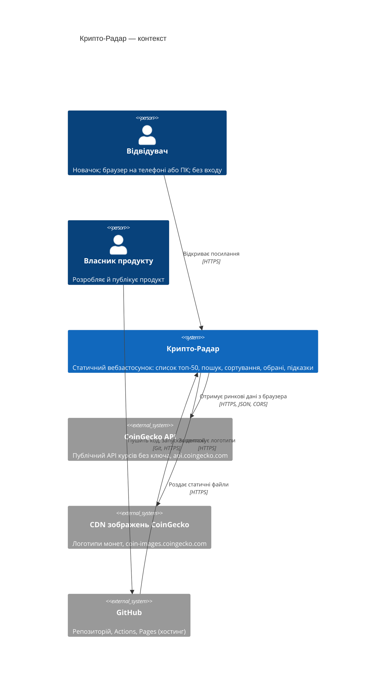
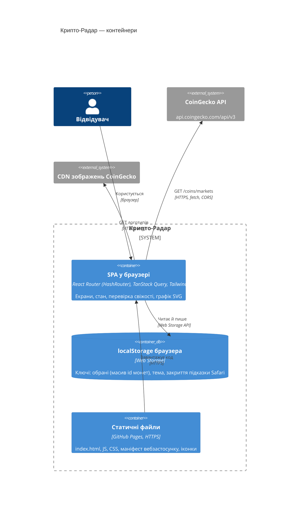
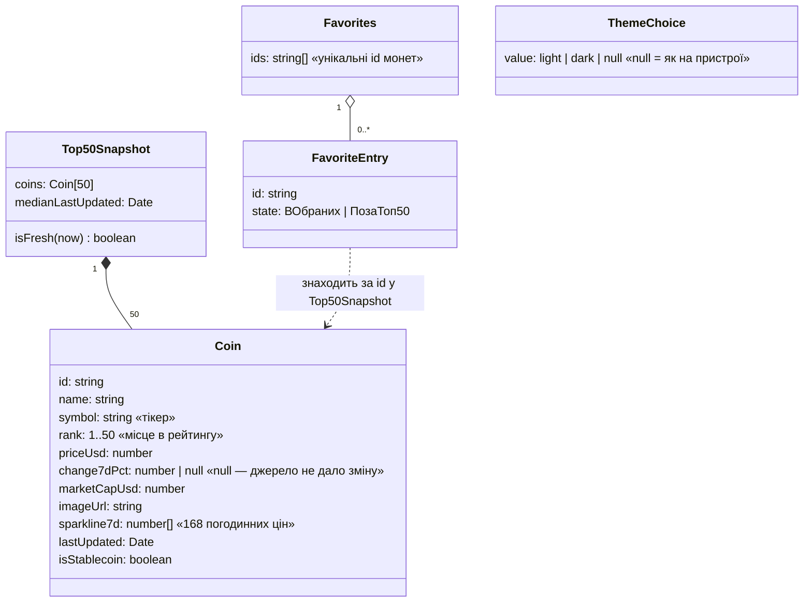
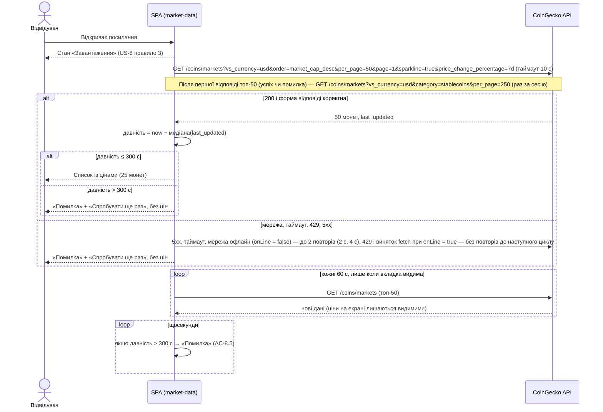
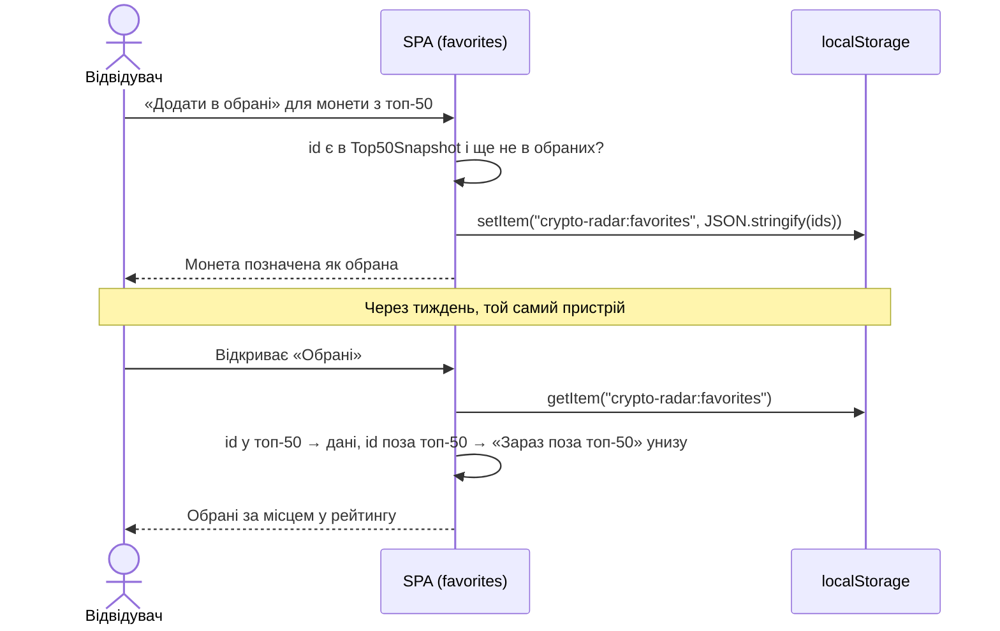
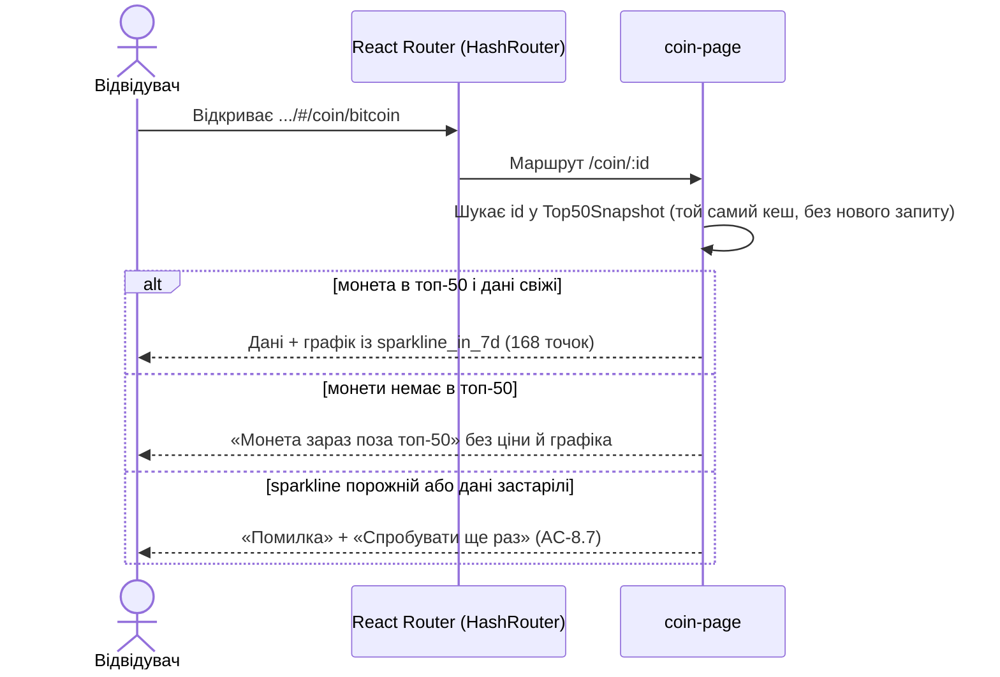

# Архітектура: Крипто-Радар

- **Етап:** Stage 3: Архітектура: NFR, ADR, STRIDE і вибір стеку
- **Дата:** 2026-11-02
- **Вхід:** `.agentic/specs/01-product-brief.md` (коміт `04c6271`), `.agentic/specs/02-requirements.md` (коміт `2ff839a`), розділ 4 `.agentic/pipeline-state.md`.
- **ADR:** [0001 стек](adr/0001-stack.md) · [0002 автентифікація](adr/0002-authentication.md) · [0003 ціль деплою](adr/0003-deploy-target.md) · [0004 сховище даних](adr/0004-data-storage.md) · [0005 джерело даних](adr/0005-data-source-coingecko.md) · [0006 обрані в Safari](adr/0006-safari-favorites-retention.md)
- **Рішення власника на етапі 3 (2026-11-02):** дані напряму з браузера до CoinGecko без власного сервера; хостинг GitHub Pages з публічним репозиторієм; React + **JavaScript** на Vite; React Router лише як бібліотека маршрутизації (декларативний режим, `HashRouter`), не як фреймворк; обмеження Safari для обраних — компроміс (ADR 0006).

---

## 1. Драйвери архітектури

| Драйвер | Джерело | Що означає для архітектури |
| :--- | :--- | :--- |
| Бюджет $0 на розробку й утримання, без домену | Бриф §13, A-8 | Лише безкоштовний хостинг статики й безкоштовний доступ до джерела даних; жодного власного сервера |
| Строк MVP до 2026-11-09, власник-початківець | Бриф §13, A-6 | Найпростіша архітектура: один деплойний блок (статичний сайт), мінімум залежностей |
| Свіжість цін ≤ 5 хв, guardrail M-5 | Бриф §9, §13; US-8 | Перевірка давності за `last_updated` на клієнті; при застарілих даних — лише помилка, без цін |
| Обрані без акаунта, на пристрої, тижнями | Бриф §10–11; US-5, US-6; A-4 | Сховище браузера (localStorage); немає акаунтів і серверного сховища |
| Телефон і ПК порівну, WCAG 2.2 AA в обох темах | Бриф §3, §13; US-7, US-10 | Адаптивна верстка, перевірка axe, власний доступний графік |
| Ринок — лише Україна, без аналітики, без реклами | Бриф §7, §11 | Немає трекерів і cookies; регуляторна таблиця — розділ 8.5 |
| Джерело даних — відкритий API на кшталт CoinGecko | Бриф §13, A-2 | CoinGecko без ключа (ADR 0005); атрибуція «Powered by CoinGecko» |
| Навчальна мета G-2, `learning_mode: true` | Бриф §8; `project.json` | Поширений стек із великою кількістю навчальних матеріалів (ADR 0001) |

**Профіль продукту:**

- **Інтерфейс:** вебзастосунок (SPA) у браузері телефона й ПК. Мобільного застосунку з магазину немає.
- **Користувачі й вхід:** одна роль «Відвідувач», входу й акаунтів немає (ADR 0002).
- **Власний HTTP API:** **немає** (`has_http_api: false`). Браузер сам звертається до CoinGecko; це зовнішня інтеграція, а не API продукту (ADR 0001, ADR 0005).
- **Дані:** продукт не має серверного сховища. На пристрої відвідувача в localStorage зберігаються лише ідентифікатори обраних монет і вибір теми (ADR 0004). Дані про ціни живуть лише в пам'яті вкладки.

**Ризикові припущення, які закриває етап 3:**

- **A-2 (джерело даних):** перевірено 2026-11-02. Пробний запит `GET https://api.coingecko.com/api/v3/coins/markets?vs_currency=usd&order=market_cap_desc&per_page=50&page=1&sparkline=true&price_change_percentage=7d` без ключа повернув 200, `Access-Control-Allow-Origin: *`, 50 монет із місцями 1–50, полем `price_change_percentage_7d_in_currency` і масивом `sparkline_in_7d.price` із 168 точок. `last_updated` у всіх 50 монет однаковий; відставання від часу запиту — близько 1 хв. Ризик лишається в тому, що ліміти keyless-доступу не задокументовані (ADR 0005).
- **A-8 (бюджет $0):** GitHub Pages для публічного репозиторію й GitHub Actions для публічного репозиторію безкоштовні (розділ 10).
- **A-10 (політика конфіденційності):** вистачить короткої примітки (розділ 8.4–8.5).
- **Відкрите питання №11 (ознака «стейблкоїн»):** закрито. Категорія `stablecoins` існує в `/coins/categories/list`, а `/coins/markets?category=stablecoins` повертає, зокрема, `tether` і `usd-coin` (перевірено 2026-11-02).

## 2. Нефункціональні вимоги (NFR)

| NFR-N | Категорія | Вимога | Поріг і умова вимірювання | Як і на якому етапі перевіряємо | Джерело |
| :--- | :--- | :--- | :--- | :--- | :--- |
| NFR-1 | Надійність даних (свіжість) | Медіанна давність показаних цін не більша за 5 хв; монета з власною давньою позначкою показується (TD-029, запит на зміну №7) | Давність = час пристрою − медіана `last_updated` серед 50 монет знімка (при парній кількості — старіша з двох середніх; запит на зміну №7: одна рідко оновлювана монета, наприклад `figure-heloc`, не ховає список); ціни видно лише при давності ≤ 300 с; при давності > 300 с або помилці запиту екран переходить у стан «Помилка» не пізніше ніж за 1 с після перетину межі. Межі 299 / 300 / 301 с | Етап 7: модульні тести з фальшивим годинником (Vitest fake timers); етап 8.b: E2E з підміненою відповіддю джерела й керованим годинником (AC-8.4, AC-8.5) | US-8, M-5, бриф §13 |
| NFR-2 | Надійність даних (оновлення) | Продукт сам оновлює дані, поки екран відкритий | Оновлення списку кожні 60 с, лише коли вкладка видима; при поверненні у вкладку — одразу, якщо дані старші за 60 с | Етап 7: модульний тест хука даних; етап 8.b: E2E з підрахунком запитів | US-8 правило 4 |
| NFR-3 | Вартість і ліміти джерела | Кількість запитів до CoinGecko не перевищує безкоштовних умов | Під час відкриття ≤ 2 запити (`markets` топ-50 + `markets?category=stablecoins`) незалежно від `visibilityState` (вкладка, відкрита у фоні, теж робить ці 2 запити — рішення власника 2026-11-03 04:41, запит на зміну №6), далі ≤ 1 запит на хвилину на видиму вкладку; після відкриття — 0 запитів у прихованій вкладці; сторінка монети не робить додаткових запитів (графік — з `sparkline_in_7d`); **успішний сценарій:** ≤ 5 запитів за 3 хв для однієї видимої вкладки; **шлях помилки:** на 429 — 0 швидких повторів (наступна спроба лише в черговий 60-секундний цикл або за «Спробувати ще раз»); на мережеву помилку при `navigator.onLine === false`, таймаут і 5xx — не більше 2 повторів з паузами 2 с і 4 с, тобто ≤ 3 запити на один збій; виняток `fetch` при `navigator.onLine === true` (так само браузер віддає 429 без CORS-заголовка, BUG-001, L-008) — «джерело недоступне» (E-SRC), 0 повторів, 1 запит (запит на зміну №5) | Етап 7: модульний тест політики повторів (429 → 0 повторів, 1 запит; виняток `fetch` при `onLine === true` → 0 повторів, 1 запит; `onLine === false`, таймаут, 5xx → 2 повтори, 3 запити); етап 8.b: E2E рахує мережеві запити за 3 хв в успішному сценарії (≤ 5) і з підміненим 429 (≤ 5: 2 запити на старті + 3 цикли по 1 запиту топ-50, без повторів); ручна перевірка в DevTools (8.a) | Бриф §13, A-2, A-8 |
| NFR-4 | Продуктивність | Огляд «за хвилину»: список з'являється швидко на телефоні | Lighthouse, мобільний профіль (емуляція повільного 4G і CPU ×4), збірка `vite preview` з підміненою відповіддю джерела: LCP ≤ 2,5 с, CLS ≤ 0,1, TBT ≤ 200 мс; медіана з 3 прогонів | Етап 5: `lhci autorun` у `debt_commands.web_vitals`; етап 8.b: повтор на всіх екранах | JTBD-1, journey крок 3 |
| NFR-5 | Продуктивність (розмір) | Початковий JavaScript невеликий | Сумарний JS, який завантажується на головному екрані, ≤ 150 КБ після gzip | Етап 5–7: вивід `vite build` (розміри gzip) у CI | JTBD-1 |
| NFR-6 | Доступність | WCAG 2.2 AA | axe-core (теги `wcag2a`, `wcag2aa`, `wcag21a`, `wcag21aa`, `wcag22aa`): 0 порушень рівнів critical і serious на кожному екрані (список, пошук без збігів, обрані порожні й заповнені, сторінка монети, «поза топ-50», завантаження, помилка) в обох темах; усі дії доступні з клавіатури; підказки відповідають 1.4.13 (можна закрити Esc, не зникають під курсором); графік має текстову альтернативу (ціна на початку й у кінці періоду, мінімум і максимум) | Етап 5: `debt_commands.accessibility` на каркасі; етап 8.a: ручна перевірка з клавіатури й зчитувачем екрана; етап 8.b: axe на всіх екранах | Бриф §13, US-7, US-10 |
| NFR-7 | Адаптивність | Телефон і ПК однаково | Без горизонтальної прокрутки сторінки на ширині 320 CSS px (WCAG 1.4.10) і 1280 CSS px; усі дані й дії кожного екрана доступні на обох ширинах; цілі дотику ≥ 24 × 24 CSS px (WCAG 2.5.8) | Етап 8.a: ручна перевірка; етап 8.b: E2E вимірює `scrollWidth ≤ clientWidth` на 320 і 1280 | Бриф §3, §13 |
| NFR-8 | Безпека (браузер) | Мінімальна поверхня атаки статичного сайту | CSP у `<meta http-equiv>`: `default-src 'self'; script-src 'self'; style-src 'self'; img-src 'self' https://coin-images.coingecko.com data:; connect-src https://api.coingecko.com; object-src 'none'; base-uri 'self'; form-action 'none'`; 0 порушень CSP у консолі на всіх екранах; у коді немає `dangerouslySetInnerHTML`, `eval`, `innerHTML`; рядки з джерела рендеряться лише як текст | Етап 5: CSP у каркасі; етап 7: правило лінтера й пошук `rg dangerouslySetInnerHTML` = 0; етап 8.b: E2E перевіряє відсутність подій `securitypolicyviolation` | OWASP A02, A05:2025 |
| NFR-9 | Безпека (ланцюг постачання) | Залежності перевірені й без відомих вразливостей | Lock-файл `pnpm-lock.yaml` у репозиторії; встановлення в CI лише `--frozen-lockfile`; `pnpm audit --audit-level high` — 0 знахідок high/critical; кожен пакет перед додаванням перевірено в реєстрі npm (існування, історія релізів, репозиторій); SBOM у форматі CycloneDX на кожну збірку релізу | Етап 5: `debt_commands.vulnerabilities`, `debt_commands.sbom`; етап 9: SBOM релізу | OWASP A03:2025, розділ 13 контракту |
| NFR-10 | Приватність | Продукт не збирає й не передає персональних даних | 0 cookies; 0 сторонніх скриптів, шрифтів і трекерів; мережеві запити лише до `api.coingecko.com` і `coin-images.coingecko.com`; у localStorage — лише 3 ключі: `crypto-radar:favorites` (масив ідентифікаторів монет), `crypto-radar:theme` і `crypto-radar:safari-hint-dismissed` (ADR 0006), без цін і даних про відвідувача; на сторінці є примітка про приватність (розділ 8.4) | Етап 8.b: E2E перевіряє `document.cookie === ""` і список доменів запитів; етап 8.a: ручний огляд DevTools → Application | Бриф §7, §13, A-10 |
| NFR-11 | Зберігання обраних | Обрані зберігаються на пристрої тижнями | Продукт ніколи сам не очищує й не обмежує строк обраних; у Chromium і Firefox обрані доступні через ≥ 30 днів без візиту (немає механізму строку дії в localStorage); у Safari діє обмеження платформи 7 днів без взаємодії — прийнятий ризик із підказкою «Додайте на головний екран» (ADR 0006) | Етап 7: модульний тест сховища (немає коду видалення за часом); етап 8.a: ручна перевірка підказки в Safari / WebKit; опитування (A-4) | US-6 правило 4, A-4 |
| NFR-12 | Надійність хостингу | Доступність і відкат | Власного SLO немає: доступність визначає GitHub Pages; RPO — не застосовно (серверних даних немає); RTO при невдалому деплої ≤ 15 хв повторним деплоєм попереднього коміту | Етап 9: репетиція відкату (повторний запуск workflow на попередньому коміті) | Бриф §13 |
| NFR-13 | Спостережуваність | Помилки видно без віддаленого логування | Немає серверних логів і віддаленої телеметрії (приватність, NFR-10); помилки джерела показуються відвідувачу станом «Помилка» (US-8); 0 помилок у консолі браузера на всіх екранах у штатних сценаріях; після деплою — smoke-перевірка в CI (головний екран повертає 200 і містить назву продукту) | Етап 8.b: E2E збирає `console.error` = 0; етап 9: smoke після деплою | US-8 |
| NFR-14 | Сумісність і підтримка | Підтримувані браузери й рантайм | Останні 2 версії Chrome, Edge, Firefox, Safari (iOS і macOS); збірка — Node.js 24 LTS (підтримка до 2028-04-30), версія в `.nvmrc` / `engines` і CI однакова | Етап 5: CI на Node 24; етап 8.a: ручна перевірка в Chrome і Safari / WebKit; етап 8.b: Playwright на Chromium і WebKit | Бриф §3, ADR 0001 |
| NFR-15 | Вартість | Утримання безкоштовне | $0 на місяць: GitHub Pages і Actions для публічного репозиторію, CoinGecko без ключа | Етап 9: огляд налаштувань GitHub (Pages, Actions) перед релізом | Бриф §13, A-8 |
| NFR-16 | Атрибуція й юридичні тексти | Вимоги джерела й брифу | Напис «Powered by CoinGecko» з посиланням на https://www.coingecko.com/en/api шрифтом ≥ 14 CSS px (умови CoinGecko: «no smaller than font size 10» без одиниці, трактуємо суворо як 10 pt = 13,33 px) і дисклеймер «Інформація не є інвестиційною порадою» видно на кожному екрані, зокрема в стані «Помилка» | Етап 8.b: E2E (AC-9.1, AC-9.2) | US-9, умови API CoinGecko §4 |

**Незастосовні категорії й пояснення:**

- **p95 часу відповіді HTTP API** — не застосовно: власного HTTP API немає (`has_http_api: false`).
- **Резервні копії, RPO** — не застосовно: серверних даних немає; обрані живуть лише на пристрої відвідувача.
- **Ліміти спроб входу, сесії, токени** — не застосовно: входу немає (ADR 0002).
- **Польовий INP** — не вимірюється: аналітики немає (NFR-10); лабораторна заміна — TBT (NFR-4).

## 3. C4 Context

## 4. C4 Container

Деплойний блок один — набір статичних файлів (артефакт `vite build`). Власного сервера, бази даних і секретів немає.

## 5. Модулі

Модуль на функціональну область. Залежності йдуть лише згори вниз; циклів немає. Межі перевіряє `dependency-cruiser` (етап 5, `debt_commands.boundaries`).

| Модуль (`src/…`) | US-N | Залежить від | Публічний інтерфейс |
| :--- | :--- | :--- | :--- |
| `app` | усі | усі нижче | Корінь застосунку: `QueryClientProvider`, `HashRouter`, маршрути, макет (шапка, дисклеймер, атрибуція, примітка про приватність) |
| `features/coin-list` | US-1, US-2, US-3 | `market-data`, `favorites`, `glossary`, `ui`, `lib` | Екран «Список монет»: таблиця/картки, «Показати більше», сортування, пошук |
| `features/coin-page` | US-4 | `market-data`, `favorites`, `glossary`, `chart`, `ui`, `lib` | Екран «Сторінка монети» за маршрутом `#/coin/:id`; «Монета зараз поза топ-50» |
| `features/favorites-view` | US-6 | `market-data`, `favorites`, `ui`, `lib` | Екран «Обрані»: порядок за рейтингом, «Зараз поза топ-50» внизу, порожній стан, підказка Safari (ADR 0006) |
| `market-data` | US-1, US-4, US-7, US-8 | `lib` | `useTopCoins()` → `{status: 'loading' \| 'fresh' \| 'error', coins, retry}`; `useStablecoinIds()`; клієнт CoinGecko (`fetch`, таймаут 10 с, перевірка форми відповіді), правило свіжості NFR-1 |
| `favorites` | US-5, US-6 | `lib` | `useFavorites()` → `{ids, add(id), remove(id), has(id)}`; читання й запис localStorage з перевіркою формату |
| `theme` | US-10 | — | `useTheme()` → `{theme, setTheme}`; початкове значення з `prefers-color-scheme` |
| `glossary` | US-7 | `ui` | Тексти 6 підказок, компонент `TermHint` |
| `chart` | US-4 | `lib` | `PriceChart7d({prices})` — SVG-лінія + текстова альтернатива |
| `ui` | US-7, US-9 | — | Доступні базові компоненти: кнопка, підказка, повідомлення про помилку, індикатор завантаження |
| `lib` | US-1, US-2, US-3 | — | Чисті функції: форматування цін і відсотків (US-1 правило 3), сортування з тай-брейком за рейтингом (US-2), пошук (US-3), `isFresh(pricesAt, now)` |

## 6. Доменна модель

Постійного сховища на сервері немає, тож модель — доменні типи (у JavaScript описуються через JSDoc) плюс три ключі localStorage (ADR 0004, ADR 0006).

| Сутність / поле | Термін глосарію | Джерело |
| :--- | :--- | :--- |
| `Coin` | Монета | `/coins/markets` |
| `name`, `symbol` | Назва монети, Тікер | `name`, `symbol` (у верхньому регістрі для показу) |
| `rank` | Місце в рейтингу | `market_cap_rank` |
| `priceUsd` | Ціна | `current_price` |
| `change7dPct` | Зміна за 7 днів | `price_change_percentage_7d_in_currency`; `null` від джерела лишається `null`: монета показується з «—» (UX §5.2 `change.none`), у сортуванні за зміною — у кінці за обох напрямів, відповідь не вважається некоректною (BUG-003, варіант Б, запит на зміну №6) |
| `marketCapUsd` | Капіталізація | `market_cap` |
| `sparkline7d` | Графік за 7 днів | `sparkline_in_7d.price` |
| `lastUpdated` | Свіжість даних | `last_updated` |
| `isStablecoin` | Стейблкоїн | `id` є у відповіді `/coins/markets?category=stablecoins` |
| `Top50Snapshot` | Топ-50, Список монет | відповідь `/coins/markets` (`per_page=50`) |
| `Favorites` | Обрані | localStorage |
| `FavoriteEntry` (`ВОбраних` / `ПозаТоп50`) | Монета в обраних (життєвий цикл 4.1 вимог) | id з localStorage + наявність у `Top50Snapshot` |
| `ThemeChoice` | Тема | localStorage |

**Власник запису й BOLA:** обрані й тема належать лише браузеру відвідувача; спільних об'єктів і ідентифікаторів відвідувачів немає, тому BOLA не застосовна (вимоги, розділ 3). **Оптимістичне блокування (`version`)** не застосовне: паралельного редагування спільних об'єктів немає. Зміни обраних з двох вкладок одного браузера синхронізуються подією `storage` (остання дія перемагає).

| Інваріант | Де гарантується |
| :--- | :--- |
| У списку монет лише місця 1–50 | `market-data`: запит `per_page=50`, фільтр `1 ≤ rank ≤ 50` після отримання |
| Ціни видно лише при давності ≤ 300 с | `market-data` (`isFresh`), компоненти отримують ціни лише в стані `fresh` (NFR-1) |
| Монета в обраних не дублюється | `favorites.add` (перевірка `has`), читання з localStorage через `new Set` |
| Додати можна лише монету з топ-50 | `favorites.add` приймає лише `id`, наявний у поточному `Top50Snapshot` |
| У localStorage лише масив рядків-ідентифікаторів | `favorites`: перевірка формату під час читання; некоректне значення → порожній список без падіння |
| Тема — лише `light`, `dark` або відсутня | `theme`: перевірка значення під час читання |

## 7. Ключові потоки

**Вхід і сесія** — не застосовно: входу немає (ADR 0002). **Створення головного об'єкта** — додавання в обрані (нижче). **Паралельне оновлення з `version` → 409** — не застосовно: спільних об'єктів немає; еквівалент — дві вкладки одного браузера (подія `storage`).

### 7.1. Відкриття списку, перевірка свіжості й фонове оновлення

Якщо запит стейблкоїнів не вдався, список працює без підказки «Стейблкоїн» (деградація без помилки даних): ця ознака не ціна й не підпадає під guardrail M-5.

### 7.2. Додавання в обрані й повернення через тиждень

### 7.3. Сторінка монети за збереженим посиланням

`HashRouter` потрібен тому, що GitHub Pages не підтримує серверних правил переписування URL: шлях після `#` браузер не надсилає на сервер, тому збережене посилання на монету завжди відкриває `index.html`.

### 7.4. Історії без окремого потоку

| US-N | Чому окремий потік не потрібен | Де описано |
| :--- | :--- | :--- |
| US-2 (сортування) | Чиста функція над знімком топ-50 у пам'яті (модуль `lib`): без мережі, сховища й зовнішніх систем; дані приходять потоком 7.1 | §5, §6 |
| US-3 (пошук) | Чиста функція пошуку підрядка над тим самим знімком у пам'яті, без мережі | §5 |
| US-7 (підказки) | Статичні тексти модуля `glossary`; ознака «стейблкоїн» приходить другим запитом потоку 7.1 | §5, §7.1 |
| US-9 (дисклеймер, джерело) | Статичний текст макета `app`, видимий в усіх станах потоку 7.1, зокрема «Помилка» | §5, NFR-16 |

## 8. Безпека й приватність

### 8.1. Автентифікація й авторизація

Автентифікації немає (ADR 0002). Єдина роль — «Відвідувач»; усі дії над обраними й темою виконуються лише в його браузері. Ідентифікаторів відвідувачів немає, тож передати «чужий» ідентифікатор неможливо.

### 8.2. Легкий STRIDE

Межі довіри: (1) браузер відвідувача ↔ GitHub Pages; (2) браузер ↔ CoinGecko API і CDN зображень; (3) локальне сховище браузера; (4) ланцюг збірки (npm → GitHub Actions → Pages).

| Компонент | Загроза | Сценарій | Захід | NFR-N / ADR | Статус |
| :--- | :--- | :--- | :--- | :--- | :--- |
| Статичні файли (GitHub Pages) | S | Підроблений сайт під схожою адресою | Єдина адреса `*.github.io` з HTTPS; посилання власник надсилає особисто | ADR 0003 | прийнятий ризик (власник, 2026-11-02, гейт етапу 3: «не проблема»; продукт без входу й платежів) |
| Статичні файли | T | Підміна файлів у дорозі | HTTPS від GitHub Pages для `github.io` + «Enforce HTTPS» | ADR 0003, NFR-8 | захід |
| Ланцюг збірки | T | Шкідливий або вигаданий пакет npm (slopsquatting) | Перевірка кожного пакета в реєстрі, lock-файл, `--frozen-lockfile`, `pnpm audit`, SBOM | NFR-9 | захід |
| Ланцюг збірки | E | Компрометація workflow або токена деплою | Деплой лише з `main` через `actions/deploy-pages` з мінімальними правами (`pages: write`, `id-token: write`), без довготривалих секретів | ADR 0003 | захід |
| SPA | T | XSS через дані джерела (назва монети з HTML) | React екранує текст; заборона `dangerouslySetInnerHTML` і `innerHTML`; CSP `script-src 'self'` | NFR-8 | захід |
| SPA | T | Некоректні або шкідливі дані CoinGecko (поля відсутні, неправильний тип) | Перевірка форми відповіді; некоректна відповідь → стан «Помилка», а не неправильні ціни; залишковий ризик — монета з власною давньою позначкою `last_updated` показується з ціною (TD-029, запит на зміну №7); єдиний виняток для форми — `null` у зміні за 7 днів (розділ 6): ціни правильні, зміна показується «—» | NFR-1, ADR 0005 | захід |
| SPA | I | Витік даних у сторонні сервіси | Немає аналітики, сторонніх скриптів і шрифтів; CSP `connect-src` лише `api.coingecko.com` | NFR-10 | захід |
| SPA | I | Clickjacking: сайт вставляють у чужий `iframe` | `frame-ancestors` неможливо задати через `<meta>`, а заголовки GitHub Pages не налаштовуються; на сторінці немає небезпечних дій (лише обрані на пристрої) | ADR 0003 | прийнятий ризик (власник, 2026-11-02, гейт етапу 3: «не проблема»; наслідок вибору GitHub Pages) |
| SPA ↔ CoinGecko | S | Підміна джерела даних | Лише HTTPS-адреса `https://api.coingecko.com`, CSP `connect-src` | NFR-8 | захід |
| SPA ↔ CoinGecko | D | Ліміт запитів (429) або недоступність CoinGecko | ≤ 1 запит/хв на видиму вкладку, на 429 без швидких повторів, стан «Помилка» + «Спробувати ще раз» | NFR-2, NFR-3, US-8 | захід + прийнятий ризик (власник, 2026-11-02, гейт етапу 3: працюємо як є, без запасного плану; ліміти keyless не задокументовані, ADR 0005) |
| SPA (перевірка свіжості) | T | Годинник пристрою відстає більш ніж на 5 хв: застарілі ціни показуються як свіжі (зачіпає guardrail M-5) | Свіжість рахується за годинником пристрою, бо заголовок `Date` недоступний через CORS; `last_updated` із майбутнього понад 60 с записується в консоль як `console.warn` (не `console.error`, NFR-13) | NFR-1, ADR 0005 | прийнятий ризик (власник, 2026-11-02, гейт етапу 3: реалізувати саме цю схему) |
| SPA ↔ CoinGecko | I | CoinGecko і його CDN бачать IP-адресу й User-Agent відвідувача | Неминуче для браузерного запиту; розкривається в примітці про приватність | NFR-10, розділ 8.4 | ризик прийнято власником 2026-11-04 00:11, п. 6 (трекер, розділ 4); прямі запити з браузера обрав власник |
| GitHub Pages | I | GitHub логує IP-адреси відвідувачів | Неминуче для хостингу; розкривається в примітці про приватність | розділ 8.4 | ризик прийнято власником 2026-11-04 00:11, п. 6 (трекер, розділ 4); хостинг GitHub Pages обрав власник |
| localStorage | T | Відвідувач або розширення змінює значення ключів | Перевірка формату під час читання; некоректне значення → порожній список | розділ 6 | захід |
| localStorage | D | Safari видаляє дані після 7 днів без взаємодії; відвідувач очищує браузер | Підказка «Додайте на головний екран» у Safari; втрата обраних при очищенні — прийнятий наслідок (US-5 правило 6) | NFR-11, ADR 0006 | прийнятий ризик (власник, 2026-11-02) |
| Усі | R | Неможливо довести, хто що зробив | Немає дій, які потребують незаперечності (немає акаунтів, платежів, спільних даних) | ADR 0002 | не застосовно |
| Усі | E | Підвищення привілеїв | Ролей і привілеїв немає | ADR 0002 | не застосовно |

### 8.3. OWASP

**OWASP Top 10:2025** (https://top10.owasp.org/2025/, перевірено 2026-11-02):

| Пункт | Застосовність | Захід |
| :--- | :--- | :--- |
| A01:2025 Broken Access Control | Частково: захищених ресурсів немає | Немає ролей і серверних даних; обрані лише в браузері (ADR 0002) |
| A02:2025 Security Misconfiguration | Так | CSP у `<meta>`, Enforce HTTPS, без source maps у продакшн-збірці (рішення етапу 5), без зайвих файлів у артефакті |
| A03:2025 Software Supply Chain Failures | Так | NFR-9: реєстр, lock-файл, audit, SBOM, закріплені версії GitHub Actions |
| A04:2025 Cryptographic Failures | Частково | Лише HTTPS (GitHub Pages, CoinGecko); власної криптографії й секретів немає |
| A05:2025 Injection | Так (XSS) | React-екранування, заборона `dangerouslySetInnerHTML`, CSP (NFR-8); пошук працює лише як підрядок у пам'яті |
| A06:2025 Insecure Design | Так | Guardrail свіжості (NFR-1), модель загроз (8.2), прийняті ризики з рішенням власника |
| A07:2025 Authentication Failures | Не застосовно | Входу немає (ADR 0002) |
| A08:2025 Software or Data Integrity Failures | Так | Перевірка форми відповіді CoinGecko; деплой лише з CI з `main` |
| A09:2025 Security Logging and Alerting Failures | Частково | Серверних логів немає; помилки джерела показуються відвідувачу (NFR-13); віддалене логування свідомо не збирається (NFR-10) |
| A10:2025 Mishandling of Exceptional Conditions | Так | Таймаут 10 с, повтори, межа помилок React (error boundary) з повідомленням українською, стан «Помилка» без цін |

**OWASP API Security Top 10 (2023)** — не застосовно як вимоги до продукту: `has_http_api: false`, власного API немає. Застосовний лише пункт про споживання стороннього API: **API10:2023 Unsafe Consumption of APIs** — перевірка форми відповіді, таймаут, лише HTTPS, повтори з обмеженням (NFR-1, NFR-3, ADR 0005).

### 8.4. Реєстр персональних даних

| Категорія | Мета | Правова підстава | Строк зберігання | Де зберігається |
| :--- | :--- | :--- | :--- | :--- |
| Ідентифікатори обраних монет, вибір теми | Функції, які відвідувач сам вмикає (US-5, US-6, US-10) | Не персональні дані: не ідентифікують людину й не залишають пристрій | Доки відвідувач не очистить браузер або (Safari) 7 днів без взаємодії | Лише localStorage браузера відвідувача |
| IP-адреса, User-Agent, час запиту (технічні дані) | Роздача сайту; відповідь API | Обробляють GitHub і CoinGecko як окремі контролери за своїми політиками; власник продукту ці дані не отримує й не обробляє | За політиками GitHub і CoinGecko (GitHub не вказує строку для журналів) | Журнали GitHub Pages («visitor's IP address is logged and stored for security purposes»), журнали CoinGecko |

Продукт сам не збирає, не передає й не зберігає персональних даних. **Примітка про приватність** (одна–дві фрази на кожному екрані або за посиланням у футері; текст — етап 4): «Крипто-Радар не використовує cookies, аналітику й реклами. Обрані монети й тема зберігаються лише у вашому браузері. Під час відкриття сайту ваш браузер звертається до GitHub (хостинг) і CoinGecko (дані про ціни), які бачать вашу IP-адресу» — з посиланнями на політики GitHub і CoinGecko. Це закриває A-10: повна політика конфіденційності не потрібна.

### 8.5. Регуляторна застосовність

Це не юридична консультація; висновки зроблено з фактів брифу.

| Регуляція | Застосовно | Факти | Наслідки (NFR-N, перевірки, документи) |
| :--- | :--- | :--- | :--- |
| **EAA** (Директива (ЄС) 2019/882) | Ні | Ринок — лише Україна (бриф §7); продукт не є e-commerce, банківською послугою, електронною книгою чи квитковою послугою; немає продажу | Заява про доступність не потрібна. Планка якості лишається: WCAG 2.2 AA (NFR-6, NFR-7) |
| **CRA** (Регламент (ЄС) 2024/2847) | Ні | Ринок — лише Україна; продукт — вебсайт, який не завантажують і не встановлюють як програму; без монетизації (бриф §7). Маніфест вебзастосунку (ADR 0006) не робить сайт товаром на ринку ЄС | Оцінка відповідності й обов'язкове повідомлення про вразливості не потрібні. Планка якості лишається: SBOM і сканування вразливостей (NFR-9) |
| **GDPR** | Ні | Ринок — лише Україна; немає установи в ЄС і пропозиції людям у ЄС; продукт сам не обробляє персональних даних (8.4) | Документів GDPR не потрібно. Якщо аудиторія вийде за межі України — переглянути (бриф §11) |
| **Закон України «Про захист персональних даних»** | Ні для власника продукту | Власник не збирає й не обробляє персональних даних; технічні дані обробляють GitHub і CoinGecko за своїми політиками | Примітка про приватність (8.4, NFR-10); повна політика не потрібна (A-10) |
| **PCI DSS** | Ні | Оплат немає (бриф §7) | — |
| **Згода на cookies і трекери (ePrivacy)** | Ні | Не ринок ЄС; cookies і трекерів немає; localStorage використовується лише для функцій, які відвідувач сам вмикає | Cookies-банер не потрібен (NFR-10). Умови використання не потрібні: дисклеймер і атрибуція (NFR-16) |
| **Умови API CoinGecko** | Так | Дані беруться з CoinGecko API (ADR 0005) | Напис «Powered by CoinGecko» шрифтом ≥ 14 CSS px, що покриває 10 pt (NFR-16); дані не перепродаються; не кешуються довше 24 год (лише в пам'яті вкладки) |

## 9. Середовища й деплой

- **`deploy_target`: `static-hosting`** — GitHub Pages через GitHub Actions (ADR 0003).
- **Середовища:**
  - `local`: `pnpm dev`, `pnpm preview`;
  - `CI`: GitHub Actions на кожен push і pull request — команда verify (етап 5);
  - `production`: GitHub Pages, деплой із `main` workflow `actions/deploy-pages`.

  Окремого staging немає. Його роль виконує `vite preview` того самого артефакту в CI перед деплоєм (smoke + axe). Це обмеження фіксує ADR 0003 для етапу 9.
- **Секрети:** немає. CoinGecko без ключа, деплой через OIDC-токен Actions (`id-token: write`) без збережених секретів. `.env.example` не потрібен; якщо етап 5 його створить, то лише з плейсхолдерами.
- **Міграції:** серверних немає. Поточні ключі localStorage без суфікса версії (`crypto-radar:favorites`); при зміні формату з'являється ключ із суфіксом (`…:v2`) і одноразове перенесення в коді (ADR 0004).
- **Резервні копії:** не застосовно (серверних даних немає).
- **Відкат:** повторний запуск workflow деплою на попередньому коміті (`workflow_dispatch` з вибором ref) або `git revert` + push у `main`. RTO ≤ 15 хв (NFR-12).
- **Відносний шлях:** сайт живе в підкаталозі `/crypto-radar/`, тому в Vite задається `base: '/crypto-radar/'` (етап 5).
- **Відомо для етапу 5:** Docker не потрібен; Node.js 24 LTS (встановлено 24.21.0), pnpm 11.23.0 (npm 11.19.0); репозиторій на GitHub (обліковий запис `ivangithubed`) має бути публічним.

## 10. Оцінка вартості

| Стаття | Запуск (разово) | Утримання на місяць | Джерело ціни й дата перевірки | Примітка |
| :--- | :--- | :--- | :--- | :--- |
| Хостинг GitHub Pages | $0 | $0 | https://docs.github.com/en/pages/getting-started-with-github-pages/creating-a-github-pages-site, 2026-11-02 | На GitHub Free репозиторій має бути публічним; ліміти: сайт ≤ 1 ГБ, м'який ліміт трафіку 100 ГБ/міс (https://docs.github.com/en/pages/getting-started-with-github-pages/github-pages-limits) |
| GitHub Actions (CI і деплой) | $0 | $0 | https://docs.github.com/en/billing/managing-billing-for-your-products/managing-billing-for-github-actions/about-billing-for-github-actions, 2026-11-02 | Стандартні раннери безкоштовні для публічних репозиторіїв і для GitHub Pages |
| CoinGecko API без ключа | $0 | $0 | https://docs.coingecko.com/docs/common-errors-rate-limit, https://www.coingecko.com/en/api, 2026-11-02 | Ліміт за IP, число не задокументоване; запасний варіант — безкоштовний Demo-ключ (100 запитів/хв, 10 000/міс), ADR 0005 |
| Домен | $0 | $0 | — | Не потрібен: адреса `ivangithubed.github.io/crypto-radar` (бриф §13) |
| **Разом** | **$0** | **$0** | | Відповідає бюджету брифу (A-8) |
