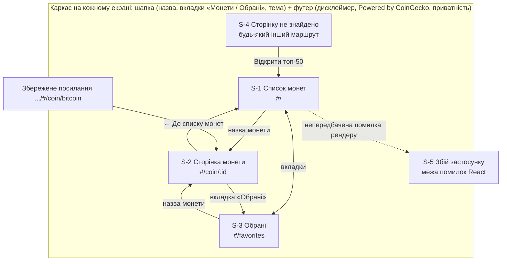
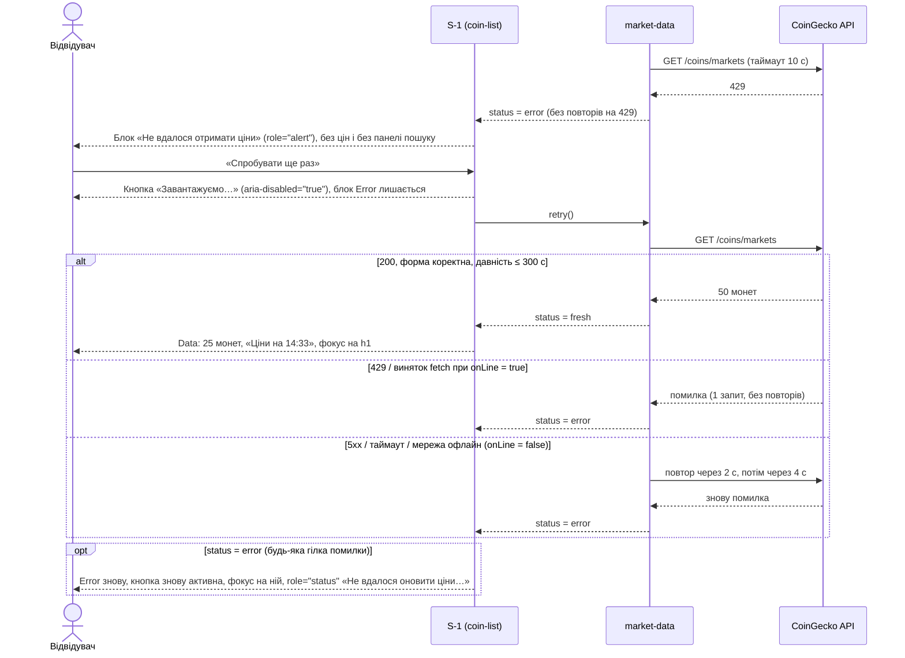
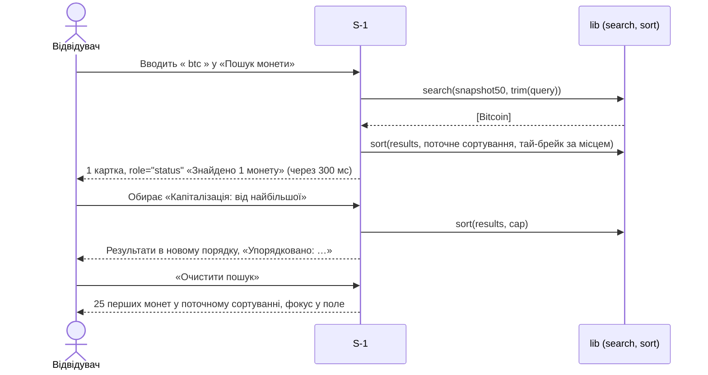
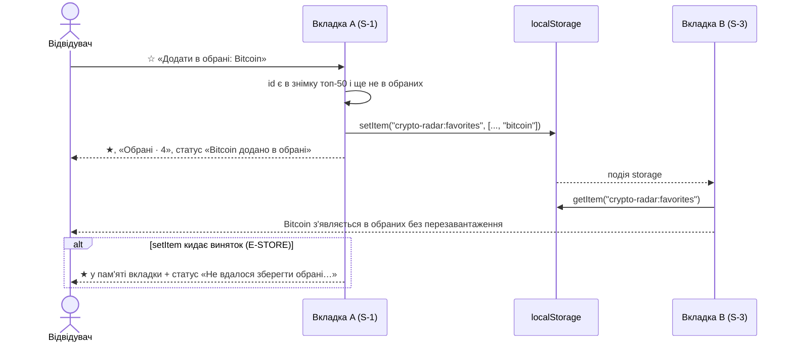
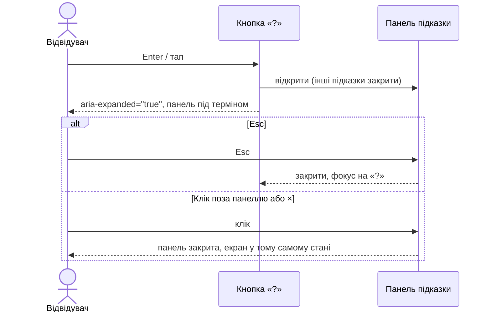

# UX і контракт інтерфейсу: Крипто-Радар

- **Етап:** Stage 4: UX і контракт API
- **Дата:** 2026-11-02
- **Вхід:** `.agentic/specs/01-product-brief.md` (`04c6271`), `.agentic/specs/02-requirements.md` (`2ff839a`), `.agentic/specs/03-architecture.md` і ADR 0001–0006 (`2edc20f`), розділ 4 `.agentic/pipeline-state.md`.
- **Рішення власника на етапі 4 (2026-11-02):** план і всі best practices Фази 2 прийнято; показувати час цін «Ціни на 14:32» (відкрите питання №12 вимог закрито); навігація — вкладки «Монети / Обрані» в шапці на всіх ширинах; нова дизайн-система в Claude Design з темно-лавандовим основним кольором; два не «попсові» шрифти з каталогу Google Fonts із кирилицею, у продукті — власні файли woff2 у складі сайту (NFR-10, CSP).
- **Артефакти Claude Design:** дизайн-система «Крипто-Радар» — https://claude.ai/artifact/4wAQ1WzRz6jSVh6J1vHymm · макети «Крипто-Радар — макети» — https://claude.ai/artifact/3k2GTvuXJvf3aKfdrvw7bb (обидва приватні, ділитися — рішення власника).

---

## 0. Тип інтерфейсу й застосовність розділів

- **Тип інтерфейсу:** графічний вебінтерфейс — SPA у браузері телефона й ПК (ADR 0001, `stack.type: "frontend-only"`, React 19 + React Router `HashRouter`, Tailwind CSS v4).
- **`has_http_api: false`.** Власного HTTP API немає: браузер сам звертається до CoinGecko (ADR 0001, ADR 0005). Тому `contract/openapi.yaml` і лінтер контракту на цьому етапі не створюються.

| Розділ | Застосовність |
| :--- | :--- |
| 1. Карта екранів | Так |
| 2. User flows | Так (US-1 – US-9 Must, US-10 Should) |
| 3. Матриця станів | Так, на кожен екран; коди 4xx/5xx замінено джерелами помилок продукту (відмова CoinGecko, застарілі дані, сховище браузера, друга вкладка) |
| 4. WCAG 2.2 AA | Так |
| 5. Тексти | Так |
| 6. Брейкпоінти | Так (веб) |
| 7. Діаграми послідовності | Так: ключові потоки інтерфейсу й звернення до стороннього API з таймаутом і повтором |
| 8. Каталог операцій API | Власного — не застосовно; замість нього каталог операцій стороннього API CoinGecko |
| 9. Дизайн-система й макети | Так (Claude Design) |

## 1. Карта екранів

Маршрути — `HashRouter` (ADR 0001, розділ 7.3 архітектури). Входу немає, тож екранів «лише для автентифікованих» і повернення після входу немає (ADR 0002).



| ID | Екран | Маршрут | US | Заголовок вкладки браузера (WCAG 2.4.2) |
| :--- | :--- | :--- | :--- | :--- |
| S-1 | Список монет (з пошуком і сортуванням) | `#/` | US-1, US-2, US-3, US-5, US-7, US-8, US-9, US-10 | «Топ-50 монет — Крипто-Радар» |
| S-2 | Сторінка монети | `#/coin/:id` | US-4, US-5, US-7, US-8, US-9 | «Bitcoin (BTC) — Крипто-Радар»; поза топ-50 — «Монета поза топ-50 — Крипто-Радар» |
| S-3 | Обрані | `#/favorites` | US-5, US-6, US-8, US-9, ADR 0006 | «Обрані — Крипто-Радар» |
| S-4 | Сторінку не знайдено | `*` | US-9 | «Сторінку не знайдено — Крипто-Радар» |
| S-5 | Збій застосунку (error boundary) | — | NFR-13, A10:2025 | «Помилка — Крипто-Радар» |

**Спільний каркас (усі екрани й усі стани, зокрема Error):** шапка — назва «Крипто-Радар» (посилання на `#/`), навігація `<nav aria-label="Основна навігація">` з вкладками «Монети» і «Обрані · N», перемикач теми; футер — дисклеймер, «Powered by CoinGecko», примітка про приватність (US-9, NFR-16, розділ 8.4 архітектури). Перше посилання сторінки — «Перейти до вмісту» (видиме у фокусі, WCAG 2.4.1).

**Стан у межах вкладки браузера:** пошуковий запит, сортування й кількість показаних монет зберігаються в пам'яті, поки вкладка відкрита (повернення зі сторінки монети відновлює список). Новий візит починає з типового сортування й порожнього пошуку (AC-2.5). Нічого з цього не пишеться в localStorage (NFR-10: лише 3 ключі).

## 2. User flows

### UF-1. Огляд ринку «за хвилину» (US-1, US-8, US-9)

1. Відвідувач відкриває посилання → S-1 у стані **Loading** (скелетон, «Завантажуємо ціни…») — AC-8.8.
2. Дані свіжі (давність ≤ 300 с) → **Data**: 25 монет за ціною від найдорожчої, лише місця 1–50 (AC-1.4), «Ціни на 14:32», дисклеймер і атрибуція, увесь текст українською без реклами — AC-1.1, AC-1.2, AC-1.4, AC-2.1, AC-9.1, AC-9.3.
3. «Показати більше» → 50 монет, кнопка зникає, фокус — на посилання 26-ї монети — AC-1.3.
4. Розгалуження: джерело недоступне, 429, таймаут, некоректна відповідь або давність > 300 с → **Error** без цін, з «Спробувати ще раз» — AC-8.1, AC-8.4, AC-2.6, AC-9.2.
   - «Спробувати ще раз» → блок Error лишається, кнопка показує «Завантажуємо…» з `aria-disabled="true"` (фокус лишається на ній) → **Data**, фокус на h1 (AC-8.2), або знову **Error**, фокус на кнопці (AC-8.3). Скелетон Loading після помилки не показується.
5. Екран відкритий: кожні 60 с фонове оновлення, ціни видно; якщо давність перевищила 300 с і оновитись не вдалося → **Error** — AC-8.5.

### UF-2. Сортування (US-2)

1. На S-1 у **Data** відвідувач обирає сортування в `<select>` «Сортування» — AC-2.2.
2. Список пересортовано по всіх 50 монетах, показано перші 25, фокус лишається на select, `role="status"` оголошує «Упорядковано: Зміна за 7 днів: найбільше зростання» — AC-2.3.
3. Рівні значення — за місцем у рейтингу — AC-2.4.
4. Разом із пошуком — результати пошуку в обраному порядку — AC-2.8; без збігів лишається «Нічого не знайдено» — AC-2.7.
5. У **Error** панель пошуку й сортування не показується — AC-2.6. Новий візит → типове сортування — AC-2.5.

### UF-3. Пошук монети (US-3)

1. Відвідувач вводить запит у поле «Пошук монети» (до 50 символів, `maxlength`) — AC-3.6.
2. Пробіли на краях ігноруються; запит лише з пробілів = порожній → звичайний список — AC-3.7, AC-3.9.
3. Збіги за частиною назви або тікера без урахування регістру серед усіх 50 → усі результати одразу, у поточному сортуванні; `role="status"` «Знайдено 2 монети» — AC-3.1, AC-3.2.
4. Збігів немає (зокрема «біткоїн», монета поза топ-50) → **Empty (пошук)** «Нічого не знайдено» + «Очистити пошук» — AC-3.3, AC-3.5, AC-3.8.
5. «Очистити пошук» (× у полі або кнопка в блоці) → 25 монет у поточному сортуванні, фокус у порожнє поле — AC-3.4.

### UF-4. Сторінка монети (US-4)

1. З S-1, результатів пошуку або S-3 відвідувач обирає назву монети → S-2 (`#/coin/<id>`) — AC-4.1, AC-4.4.
2. Монета в топ-50, дані свіжі → **Data**: назва, тікер, місце, ціна, зміна, капіталізація, графік за 7 днів із текстовою альтернативою; вибору періоду немає — AC-4.1, AC-4.2.
3. Відкрито за збереженим посиланням: знімок топ-50 ще вантажиться → **Loading**; монети немає в топ-50 → **Поза топ-50** без ціни й графіка, додати в обрані не можна — AC-4.3, AC-5.5.
4. Немає даних графіка або дані застарілі → **Error** — AC-8.7.

### UF-5. Обрані: додати, прибрати, повернутися (US-5, US-6)

1. На S-1 (картка чи рядок), у результатах пошуку або на S-2 відвідувач натискає ☆ (ім'я кнопки «Додати в обрані: Bitcoin») → ★, ім'я кнопки стає «Прибрати з обраних: Bitcoin», лічильник у вкладці «Обрані · N», статус «Bitcoin додано в обрані»; входу не пропонують — AC-5.1, AC-5.2.
2. Для монети в обраних доступна лише дія «Прибрати з обраних» (повторне натискання ★) — AC-5.3, AC-5.4, AC-5.7. Кількість — від 0 до 50 — AC-5.6.
3. Через тиждень на тому самому пристрої S-3 показує обрані з поточними цінами за місцем у рейтингу — AC-6.1, AC-6.5, AC-6.7. На іншому пристрої — **Empty** — AC-6.2, AC-6.3.
4. Монета вибула з топ-50 → внизу з позначкою «Зараз поза топ-50», без цін, ★ дозволяє прибрати; повернулася — знову з даними — AC-6.4, AC-6.6.
5. У **Error** обрані не зникають; після «Спробувати ще раз» — знову з цінами — AC-8.6.
6. Safari, не з головного екрана, порада не закрита → блок «Щоб обрані не зникли в Safari» на S-3 (ADR 0006).

### UF-6. Підказки до термінів (US-7)

1. Відвідувач натискає «?» біля терміна (клік, тап, Enter або Пробіл) → панель із 1–2 реченнями під терміном, `aria-expanded="true"` — AC-7.1, AC-7.4.
2. Esc, ×, повторне «?» або клік поза панеллю → панель закрита, фокус на «?», список у тому самому стані — AC-7.2.
3. «Стейблкоїн» — лише біля монет із ознакою `isStablecoin` (у списку й на S-2) — AC-7.3. Якщо запит стейблкоїнів не вдався — мітки немає, помилки немає (**Partial**, розділ 7.1 архітектури).

### UF-7. Тема (US-10, Should)

1. Перший візит — тема як на пристрої (`prefers-color-scheme`) — AC-10.1.
2. Перемикач у шапці → інша тема на всіх екранах, вибір у `crypto-radar:theme` — AC-10.2.
3. Тема застосовується до першого малювання: окремий синхронний файл `public/theme-init.js`, підключений у `<head>` через `<script src>` (дозволений CSP `script-src 'self'`, NFR-8), ставить `data-theme` до завантаження React, щоб не було спалаху іншої теми. Inline-скрипт у `index.html` заборонений: CSP без хешів його заблокує.

## 3. Екрани й матриці станів

Джерело даних усіх екранів із цінами — один знімок топ-50 у пам'яті вкладки (`useTopCoins()`: `loading | fresh | error`, розділ 5 архітектури) і `useStablecoinIds()`; обрані й тема — localStorage (ADR 0004). Власних операцій API немає.

**Загальні джерела помилок продукту** (замість 4xx/5xx):

| Код у документі | Що сталося | Як визначає SPA | Стан екрана |
| :--- | :--- | :--- | :--- |
| E-NET | Немає мережі | `fetch` кидає помилку, `navigator.onLine === false`; до 2 повторів (2 с, 4 с) | Error, текст «Немає з'єднання» |
| E-SRC | CoinGecko недоступний: 5xx або таймаут 10 с — після 2 повторів (2 с, 4 с); `fetch` кидає помилку при `navigator.onLine === true` (так само виглядає 429 без CORS-заголовка) — без повторів, 1 запит (запит на зміну №5) | статус / таймаут / виняток `fetch` онлайн | Error, текст «Не вдалося отримати ціни» |
| E-429 | Ліміт запитів CoinGecko | статус 429, без повторів (NFR-3) | Error, той самий текст; наступна спроба — у 60-секундний цикл або за кнопкою |
| E-SHAPE | Некоректна відповідь (немає полів, неправильні типи, менше ніж 50 монет). Виняток: `null` у зміні за 7 днів — не помилка, монета лишається зі значенням «—» (BUG-003, варіант Б, запит на зміну №6) | перевірка форми відповіді (ADR 0005) | Error, текст «Не вдалося отримати ціни» |
| E-STALE | Давність > 300 с (NFR-1) | `now − медіана(last_updated) > 300 с` | Error, текст «Ціни застаріли» |
| E-STORE | localStorage недоступний або переповнений | виняток під час `setItem` / `getItem` | Повідомлення біля обраних; ціни працюють |
| C-TAB | Обрані змінено в іншій вкладці | подія `storage` | Conflict: тихо оновити ★ і список, остання дія перемагає |

### S-1. Список монет (`#/`)

- **Призначення:** огляд топ-50 «за хвилину» з пошуком, сортуванням, обраними й підказками.
- **US / AC:** US-1 (AC-1.1–1.5), US-2 (AC-2.1–2.8), US-3 (AC-3.1–3.9), US-5 (AC-5.1, 5.4, 5.6, 5.7), US-7 (AC-7.1–7.4), US-8 (AC-8.1–8.5, 8.8), US-9 (AC-9.1–9.3), US-10.
- **Роль:** відвідувач (єдина).
- **Джерело даних:** `useTopCoins()`, `useStablecoinIds()`, `useFavorites()`.
- **Макети:** `Main`, `M-List-Loading`, `M-List-Error`, `M-Search-Empty`, `D-List` (розділ 9.4).
- **Вайрфрейм (зверху вниз):**
  1. Шапка.
  2. Рядок: h1 «Топ-50 монет» · «Ціни на 14:32» (на ПК — «Ціни на 14:32 · оновлюються щохвилини»).
  3. Панель: поле «Пошук монети» (× «Очистити пошук», коли є текст) і select «Сортування».
  4. Телефон: рядок термінів «Місце ? · Тікер ? · Зміна за 7 днів ? · Капіталізація ?». ПК: ті самі «?» у заголовках колонок таблиці.
  5. Список: телефон — картки `<ol>` (місце, логотип, назва-посилання, тікер, [Стейблкоїн ?], ★; ціна й зміна; капіталізація). ПК — `<table>` з колонками «№ · Монета · тікер · Ціна · Зміна за 7 днів · Капіталізація · ★».
  6. Головна дія під списком: «Показати більше» (лише коли показано 25 з 50 і пошук порожній).
  7. Футер.

| Стан | Коли виникає | Що бачить відвідувач | Доступність | Відновлення |
| :--- | :--- | :--- | :--- | :--- |
| Loading | Перше відкриття (до першої відповіді) | Шапка, h1, скелетон панелі й 6 карток (телефон) або 10 рядків (ПК) у розмір справжніх; цін немає | `aria-busy="true"` на `<main>`, `role="status"` «Завантажуємо ціни…» | — |
| Data | Знімок свіжий | 25 монет (або 50 після «Показати більше»), «Ціни на ЧЧ:ХХ» | Таблиця з `<caption>` і `<th scope="col">` / список `<ol aria-label="Монети, 25 з 50">`; ★ — кнопка-дія з ім'ям «Додати в обрані: {назва}» / «Прибрати з обраних: {назва}» (розділ 3.1) | — |
| Data (фонове оновлення) | Кожні 60 с у видимій вкладці | Значення цін, змін, капіталізації й час оновлюються **на місці**; порядок рядків не змінюється до наступної дії відвідувача (зміна сортування, пошук, «Показати більше», повернення на екран), тому рядки не стрибають. Виняток: склад топ-50 змінився (монета вибула або увійшла) — список перебудовується в поточному сортуванні, бо ціни вибулої монети вже не свіжі. Фокус лишається на тому самому елементі (за `id` монети; якщо монета вибула — на h1), відкрита підказка не закривається, поле пошуку не скидається | Без оголошень (не заважати зчитувачу) | — |
| Empty (пошук) | Запит без збігів | Поле з запитом, select, блок «Нічого не знайдено» + «Очистити пошук» | `role="status"` «Нічого не знайдено»; блок у фокус-порядку | «Очистити пошук» → 25 монет |
| Empty (дані) | — | **Не застосовно:** порожній топ-50 буває лише без даних — це Error (US-1 правило 5) | — | — |
| Error | E-NET, E-SRC, E-429, E-SHAPE, E-STALE | h1, блок помилки (заголовок, пояснення, «Спробувати ще раз»), рядок «Ваші обрані збережені»; **жодної ціни**, панелі пошуку й сортування немає | Блок `role="alert"`; якщо фокус був у зниклій панелі — фокус на заголовок блоку (`tabindex="-1"`) | «Спробувати ще раз»: блок лишається, кнопка «Завантажуємо…» (`aria-disabled`), далі Data (фокус на h1) або знову Error (фокус на кнопці, `role="status"` оголошує `error.retryFailed`); автоматична спроба — у наступному 60-секундному циклі |
| Partial | Не вдався запит стейблкоїнів | Список без міток «Стейблкоїн»; помилки немає | — | Повтор при наступному відкритті |
| Conflict | C-TAB | ★ і лічильник «Обрані · N» оновлюються самі | Без оголошення | — (остання дія перемагає) |
| Error (сховище) | E-STORE при натисканні ★ | ★ перемикається, під панеллю — «Не вдалося зберегти обрані: браузер не дозволяє зберігати дані сайту (наприклад, у приватному режимі). Обрані діятимуть до закриття вкладки.» | `role="status"` | — |

### S-2. Сторінка монети (`#/coin/:id`)

- **Призначення:** дані однієї монети й графік ціни за 7 днів.
- **US / AC:** US-4 (AC-4.1–4.4), US-5 (AC-5.2, 5.5), US-7 (AC-7.1 «Волатильність», «Стейблкоїн»), US-8 (AC-8.7), US-9.
- **Джерело даних:** той самий знімок `useTopCoins()` (без додаткових запитів, NFR-3), `sparkline_in_7d.price` (168 точок).
- **Макети:** `M-Coin`, `M-Coin-Out`, `D-Coin`.
- **Вайрфрейм:**
  1. Шапка (жодна вкладка не активна).
  2. «← До списку монет».
  3. Заголовок: логотип 40×40, h1 «Bitcoin», тікер «BTC», [Стейблкоїн ?], ★ (телефон) / кнопка «★ Прибрати з обраних» (ПК).
  4. Ціна (`num-l`) і зміна за 7 днів; «Ціни на ЧЧ:ХХ».
  5. Блок «Графік за 7 днів ?» (підказка «Волатильність»): SVG-лінія, підписи першого й останнього дня, текстова альтернатива під графіком.
  6. Список `<dl>`: Місце в рейтингу ?, Тікер ?, (ПК: Ціна), Зміна за 7 днів ?, Капіталізація ?.
  7. Футер. Від 1024 px — графік ліворуч (2/3), список даних праворуч (1/3).

| Стан | Коли виникає | Що бачить відвідувач | Доступність | Відновлення |
| :--- | :--- | :--- | :--- | :--- |
| Loading | Знімок ще вантажиться (пряме посилання) | «← До списку монет», скелетон заголовка, ціни й графіка | `aria-busy`, `role="status"` «Завантажуємо дані монети…» | — |
| Data | Монета в знімку, дані свіжі, `sparkline` не порожній | Усі дані й графік | Графік `aria-hidden`, текстова альтернатива `<p>`: «Ціна за 7 днів: на початку $64 540, наприкінці $67 250, мінімум …, максимум …» (NFR-6) | — |
| Поза топ-50 | `id` немає в знімку топ-50 (зокрема невідомий `id`) | h1 «Монета зараз поза топ-50», пояснення, «★ Прибрати з обраних» (лише якщо монета в обраних), «Відкрити топ-50»; цін і графіка немає | Блок `role="status"`; додавання в обрані недоступне (кнопки немає) | «Відкрити топ-50» |
| Empty | — | **Не застосовно:** сторінка завжди має або дані, або «Поза топ-50», або Error | — | — |
| Error | E-* з таблиці вище; порожній `sparkline` (AC-8.7) | Блок помилки замість ціни, графіка й даних; заголовок «Bitcoin» лишається, якщо назва відома з останнього знімка, інакше h1 «Дані монети недоступні» | `role="alert"` | «Спробувати ще раз» |
| Partial | Не вдався запит стейблкоїнів | Без мітки «Стейблкоїн» | — | — |
| Conflict | C-TAB | ★ оновлюється сама | — | — |
| Error (сховище) | E-STORE при натисканні ★ | ★ перемикається в пам'яті вкладки, під заголовком — текст `store.writeFail` | `role="status"` | — |

### S-3. Обрані (`#/favorites`)

- **Призначення:** «мій ринок за хвилину» — обрані монети з поточними даними.
- **US / AC:** US-5 (AC-5.3), US-6 (AC-6.1–6.7), US-8 (AC-8.6), US-9, ADR 0006.
- **Джерело даних:** `useFavorites()` (localStorage `crypto-radar:favorites`) + знімок `useTopCoins()`.
- **Макети:** `M-Fav-Empty`, `M-Fav`.
- **Вайрфрейм:** шапка (вкладка «Обрані» активна) → h1 «Обрані» · «Ціни на ЧЧ:ХХ» → [порада Safari] → список (як на S-1, порядок за місцем у рейтингу; монети «Зараз поза топ-50» унизу) → футер. Пошуку, сортування й «Показати більше» немає (обраних ≤ 50 + вибулі).

| Стан | Коли виникає | Що бачить відвідувач | Доступність | Відновлення |
| :--- | :--- | :--- | :--- | :--- |
| Loading | Є обрані, знімок вантажиться | Скелетон стільки карток, скільки обраних (до 6) | `aria-busy`, `role="status"` | — |
| Empty | Обраних 0 (новий пристрій, інший браузер, очищені дані) | «Тут поки порожньо», пояснення про ☆, «Перейти до топ-50» | Заголовок h2 і посилання у фокус-порядку | «Перейти до топ-50» |
| Data | Обрані є, знімок свіжий | Монети за місцем; вибулі — унизу з «Зараз поза топ-50 — ціни не показуємо» і ★ | `<ol aria-label="Обрані монети, 4">`; після прибирання фокус переходить на ★ наступної монети або на h1, якщо список спорожнів; статус «Bitcoin прибрано з обраних» | — |
| Error | E-* | Блок помилки замість списку; рядок «Ваші обрані збережені: 4 монети» | `role="alert"` | «Спробувати ще раз» → Data з тими самими обраними (AC-8.6) |
| Порада Safari | Safari / WebKit, не `display-mode: standalone`, `crypto-radar:safari-hint-dismissed` не встановлено | Блок `brand-soft` над списком (у Empty — під ним) з × «Закрити пораду» | Звичайний блок із заголовком h2 | × → більше не показується |
| Partial | Не вдався запит стейблкоїнів | Без міток «Стейблкоїн» | — | — |
| Conflict | C-TAB | Список оновлюється сам | — | — |
| Error (сховище) | E-STORE під час читання | Empty з текстом «Не вдалося прочитати обрані: браузер не дозволяє зберігати дані сайту.» | `role="status"` | — |

### S-4. Сторінку не знайдено (`*`)

| Стан | Коли виникає | Що бачить відвідувач | Доступність | Відновлення |
| :--- | :--- | :--- | :--- | :--- |
| Data | Невідомий маршрут (`#/abc`) | h1 «Сторінку не знайдено», «Такої сторінки в Крипто-Радарі немає.», посилання «Відкрити топ-50» | Фокус на h1 | Посилання |
| Loading, Empty, Error, Partial, Conflict | — | **Не застосовно:** статичний екран без даних | — | — |

### S-5. Збій застосунку (межа помилок React)

| Стан | Коли виникає | Що бачить відвідувач | Доступність | Відновлення |
| :--- | :--- | :--- | :--- | :--- |
| Error | Непередбачена помилка рендеру (A10:2025) | h1 «Щось пішло не так», «Перезавантажте сторінку. Ваші обрані збережені.», кнопка «Перезавантажити сторінку»; дисклеймер і атрибуція лишаються | `role="alert"`, фокус на h1 | `location.reload()` |
| Loading, Empty, Data, Partial, Conflict | — | **Не застосовно:** запасний екран без даних | — | — |

### 3.1. Компоненти зі станами

| Компонент | Стани | Поведінка |
| :--- | :--- | :--- |
| ★ Обрані (`FavoriteToggle`) | не в обраних ☆ / в обраних ★ / недоступно (поза топ-50 і не в обраних — кнопки немає) / hover / focus | **Кнопка-дія без `aria-pressed`** (AC-5.4: для обраної монети доступна лише дія «Прибрати з обраних»). Ім'я починається з дії, назва монети — наприкінці: «Додати в обрані: Bitcoin» / «Прибрати з обраних: Bitcoin»; на ПК (S-2) видимий текст «Додати в обрані» / «Прибрати з обраних», гліф ★/☆ `aria-hidden`. Ціль 32×32 (на ПК — кнопка 44 px); статус про результат |
| «?» Підказка (`TermHint`) | закрита / відкрита / hover / focus | Розділ 4, критерій 1.4.13; одночасно відкрита одна |
| «Показати більше» | видима (25 з 50, пошук порожній) / прихована | Після натиску фокус на посилання 26-ї монети, статус «Показано 50 з 50» |
| «Спробувати ще раз» | активна / «Завантажуємо…» (`aria-disabled="true"`, фокус не втрачається) | Не можна натиснути двічі; блок Error не замінюється скелетоном; після відповіді — Data (фокус на h1) або знову Error (фокус на кнопці) |
| Поле пошуку | порожнє / із текстом (× видно) / досягнуто 50 символів | 51-й символ не вводиться (`maxlength`), без окремої помилки |
| Перемикач теми | світла / темна | `aria-label` називає дію («Увімкнути темну тему») |

## 4. Доступність (WCAG 2.2 AA)

Поріг і інструменти — NFR-6, NFR-7: axe-core без порушень critical/serious на кожному екрані й стані з розділу 3 в обох темах; ручна перевірка з клавіатури й зчитувачем екрана.

| Критерій | Вимога до інтерфейсу | Як перевіряємо |
| :--- | :--- | :--- |
| 1.1.1 Нетекстовий вміст | Логотипи монет `alt=""` (назва поруч); графік `aria-hidden` + текстова альтернатива (початок, кінець, мінімум, максимум); гліфи ★ ? × ☾ ☀ ▲ ▼ мають текст для зчитувача | Етап 8.b: axe; 8.a: зчитувач |
| 1.3.1 Інформація і зв'язки | Таблиця з `<caption>`, `<th scope="col">`; картки — `<ol>`; дані монети — `<dl>`; заголовки h1 → h2 без пропусків; підписи `<label for>` | 8.b: axe; 7: тести Testing Library за ролями |
| 1.3.5 Мета поля | Поле пошуку `autocomplete="off"` (не персональні дані) | 8.a |
| 1.4.1 Колір | Зміна за 7 днів — знак «+»/«−», стрілка й слово для зчитувача; активна вкладка — заливка `brand`, текст `on-brand` (≥ 3:1 проти сусідніх вкладок і фону) + `aria-current="page"` | 8.a: перегляд у відтінках сірого |
| 1.4.3 Контраст тексту | ≥ 4.5:1 у світлій і темній темі (пари в розділі 9.2; мінімум серед пар продукту — 5.46:1, `ink-muted` на `brand-soft` у світлій; `up` і `down` стоять лише на `surface-raised`) | 5–8.b: axe в обох темах |
| 1.4.4, 1.4.12 Масштабування й інтервали | Текст у `rem`, без фіксованої висоти текстових блоків; до 200 % без втрати вмісту | 8.a |
| 1.4.10 Reflow | Без горизонтальної прокрутки сторінки від 320 CSS px; таблиця ПК з'являється лише від 768 px | 8.b: `scrollWidth ≤ clientWidth` на 320 і 1280 (NFR-7) |
| 1.4.11 Нетекстовий контраст | Межі полів і кнопок `line-strong` ≥ 3:1 на `surface`, `surface-raised`, `surface-sunken`, `error-surface` (мінімум 3.28:1 — темна тема на `error-surface`); **межі `line-strong` на `brand-soft` заборонені** (3.07:1 / 2.81:1) — кнопки в блоках `brand-soft` без межі; активна вкладка — заливка `brand` (8.4:1 / 8.7:1 проти `surface`); кільце фокусу `focus` ≥ 6.6:1; лінія графіка `brand` ≥ 6.6:1 | 8.a: вимір пар; 8.b: axe |
| 1.4.13 Вміст при наведенні чи фокусі | Підказка відкривається лише натиском, закривається Esc / × / повторним «?», не зникає під курсором, не перекриває свою кнопку | 7: тест компонента; 8.a: ручна перевірка |
| 2.1.1, 2.1.2 Клавіатура | Усі дії з клавіатури (Tab, Enter, Пробіл, Esc); без пасток — підказка не тримає фокус | 8.a: проходження всіх flows без миші |
| 2.2.2 Пауза, зупинка, приховування | Ціни оновлюються автоматично кожні 60 с без руху й блимання. Механізму паузи немає: оновлення — суттєва частина функції (виняток «essential»), бо guardrail M-5 і NFR-1 забороняють показувати набір цін із медіанною давністю понад 5 хв; зупинка оновлення означала б стан Error | 8.a: перевірка, що під час оновлення нічого не рухається |
| 1.3.4 Орієнтація | Працює в книжковій і альбомній орієнтації, без блокування | 8.a |
| 2.4.4 Мета посилання | Посилання на монету — її назва; «← До списку монет», «Відкрити топ-50», «Powered by CoinGecko» зрозумілі без контексту | 8.b: axe |
| 2.5.7 Перетягування | **Не застосовно:** перетягування в інтерфейсі немає | — |
| 3.2.3 Послідовна навігація | Шапка й футер однакові на всіх екранах і в усіх станах | 8.a |
| 3.2.6 Послідовна допомога | **Не застосовно:** механізмів допомоги (контакти, чат) немає; підказки до термінів — частина вмісту | — |
| 3.3.7 Надлишкове введення | **Не застосовно:** багатокрокових форм немає; пошуковий запит зберігається в межах вкладки | — |
| 2.4.1 Пропуск блоків | Посилання «Перейти до вмісту» першим у порядку фокуса | 8.b |
| 2.4.2 Заголовок сторінки | `document.title` за таблицею розділу 1 при кожній зміні маршруту | 8.b |
| 2.4.3 Порядок фокуса | Шапка → панель → список → «Показати більше» → футер; після зміни маршруту фокус на h1; після повернення зі сторінки монети до списку — на посилання цієї монети, якщо воно на екрані, інакше на h1 (рішення власника 2026-11-04 00:11, запит на зміну №6) | 8.a |
| 2.4.6 Заголовки й підписи | Один h1 на екран; підписи «Пошук монети», «Сортування» | 8.b: axe |
| 2.4.7, 2.4.11 Видимий і неперекритий фокус | Кільце 2 px `focus` з відступом 2 px; шапка не липка, тож фокус не ховається | 8.a |
| 2.5.3 Мітка в імені | Доступне ім'я починається з видимого тексту: «Показати більше», «Спробувати ще раз», «Прибрати з обраних: Bitcoin» для кнопки з видимим «★ Прибрати з обраних» | 8.b: axe; 8.a: голосове керування за видимим текстом |
| 2.5.8 Розмір цілі | Кнопки ≥ 44 px заввишки; ★, «?», × — 32×32; на телефоні «?» у рядку термінів — 24×24 з проміжком ≥ 8 px | 8.b: вимір `getBoundingClientRect` |
| 3.1.1 Мова сторінки | `<html lang="uk">`; назви монет латиницею без `lang` (власні назви) | 8.b |
| 3.1.2 Мова частин | «Powered by CoinGecko» — англійська фраза (не власна назва): `<span lang="en">Powered by CoinGecko</span>`; назви монет і тікери — власні назви, без `lang` | 8.a: зчитувач вимовляє фразу англійською; 8.b: перевірка атрибута `lang="en"` |
| 3.2.2 Введення | Зміна сортування не переносить фокус і не відкриває новий екран | 8.a |
| 3.3.1, 3.3.3 Помилки й підказки | Помилки даних кажуть, що сталося і що зробити; поле пошуку не має помилкових станів (обмеження — `maxlength`) | 8.a: тексти розділу 5 |
| 3.3.2 Підписи або інструкції | Видимі підписи над полем і select; плейсхолдер — лише приклад | 8.b: axe |
| 3.3.8 Доступна автентифікація | **Не застосовно:** входу немає (ADR 0002) | — |
| 4.1.2 Ім'я, роль, значення | Нативні `<button>`, `<a>`, `<select>`, `<input>`; `aria-expanded` («?»), `aria-current` (вкладки); ★ — кнопка-дія, стан передає її ім'я, без `aria-pressed` (не поєднувати змінну мітку з `aria-pressed`, WAI-ARIA APG) | 8.b: axe |
| 4.1.3 Повідомлення про статус | `role="status"`: «Завантажуємо ціни…», «Знайдено N монет», «Нічого не знайдено», «Bitcoin додано в обрані», «Упорядковано: …», «Не вдалося оновити ціни…» після невдалого повтору; `role="alert"` — блоки Error | 8.a: зчитувач (NVDA або VoiceOver) |
| 2.3.3 (AAA, добровільно) / `prefers-reduced-motion` | Пульсацію скелетона вимкнено при `reduce`; інших анімацій немає | 8.a |

## 5. Тексти й мікрокопірайт

Правила: українською, на «ви»; кнопка = дієслово + об'єкт; помилка = що сталося + що зробити, без кодів і вибачень; терміни лише з глосарію вимог; без емодзі (гліфи ★ ? × — елементи керування з текстом для зчитувача). Незворотних дій у продукті немає (прибирання з обраних повертається повторним натиском ★), тому діалогів підтвердження немає.

### 5.1. Підказки до термінів (відкрите питання №13 вимог)

| Ключ | Термін | Текст підказки | Де |
| :--- | :--- | :--- | :--- |
| `hint.marketCap` | Капіталізація | Скільки коштують усі монети цього виду разом: ціна однієї монети, помножена на кількість монет в обігу. Чим більша капіталізація, тим вище монета в рейтингу. | S-1, S-2 |
| `hint.change7d` | Зміна за 7 днів | На скільки відсотків ціна монети зараз вища (+) або нижча (−), ніж рівно тиждень тому. | S-1, S-2 |
| `hint.ticker` | Тікер | Коротке позначення монети з кількох латинських літер, як у акцій на біржі. Наприклад, BTC — це Bitcoin. | S-1, S-2 |
| `hint.rank` | Місце в рейтингу | Номер монети серед усіх криптовалют за капіталізацією. Bitcoin має місце 1, бо він найбільший. | S-1, S-2 |
| `hint.stablecoin` | Стейблкоїн | Монета, ціна якої прив'язана до звичайної валюти, найчастіше до долара США. Тому її ціна майже не змінюється — близько $1. | S-1, S-2 біля монет з `isStablecoin` |
| `hint.volatility` | Волатильність | Наскільки сильно й часто стрибає ціна. Що більше різких злетів і падінь на графіку, то вища волатильність і ризик. | S-2 біля графіка |

### 5.2. Інтерфейс, стани й помилки

| Ключ | Текст | Де | Примітка |
| :--- | :--- | :--- | :--- |
| `app.name` | Крипто-Радар | Шапка, `document.title` | Шрифт `display-l` |
| `nav.label` | Основна навігація | `<nav aria-label>` | Для зчитувача |
| `nav.list` | Монети | Вкладка | |
| `nav.favorites` | Обрані · {N} | Вкладка | Для зчитувача «Обрані, {N} монет(и)»; при 0 — «Обрані» |
| `nav.skip` | Перейти до вмісту | Перше посилання | Видиме у фокусі |
| `theme.toDark` / `theme.toLight` | Увімкнути темну тему / Увімкнути світлу тему | `aria-label` перемикача | |
| `list.title` | Топ-50 монет | h1 S-1 | |
| `prices.time` | Ціни на {ЧЧ:ХХ} | S-1, S-2, S-3 | Час медіани `last_updated` (запит на зміну №7), 24-годинний формат, час пристрою |
| `prices.refresh` | оновлюються щохвилини | S-1 від 768 px | Після `prices.time` через « · » |
| `search.label` | Пошук монети | Підпис поля | |
| `search.placeholder` | Назва або тікер, напр. btc | Плейсхолдер | |
| `search.clear` | Очистити пошук | × у полі (`aria-label`), кнопка в Empty | |
| `search.found` | Знайдено {N} монет(у/и) | `role="status"` | Узгодження числівника: 1 монету, 2–4 монети, 5+ монет |
| `search.empty.title` | Нічого не знайдено | Empty (пошук) | AC-3.3 — точний текст |
| `search.empty.text` | Шукаємо лише серед топ-50 монет за назвою латиницею (Bitcoin) або тікером (BTC). | Empty (пошук) | Пояснює AC-3.5, AC-3.8 |
| `sort.label` | Сортування | Підпис select | |
| `sort.price` | Ціна: від найдорожчої | Опція (типова) | Точні тексти з US-2 правило 2 |
| `sort.gain` | Зміна за 7 днів: найбільше зростання | Опція | |
| `sort.loss` | Зміна за 7 днів: найбільше падіння | Опція | |
| `sort.cap` | Капіталізація: від найбільшої | Опція | |
| `sort.announce` | Упорядковано: {назва сортування} | `role="status"` | |
| `list.more` | Показати більше | Кнопка | |
| `list.shown` | Показано {N} з 50 | `role="status"` після «Показати більше», `<caption>` | |
| `col.rank` / `col.coin` / `col.price` / `col.change` / `col.cap` | № / Монета · тікер / Ціна / Зміна за 7 днів / Капіталізація | Заголовки таблиці ПК | |
| `coin.stableTag` | Стейблкоїн | Мітка біля монети | + «?» `hint.stablecoin` |
| `change.up` / `change.down` / `change.flat` | зростання на {X} % / падіння на {X} % / без змін | Текст для зчитувача | Візуально «▲ +4,2 %», «▼ −3,7 %», «0,0 %» |
| `change.none` | немає даних | Текст для зчитувача, коли зміни немає (`null`) | Візуально «—», у сортуванні за зміною — у кінці за обох напрямів (запит на зміну №6) |
| `fav.add` / `fav.remove` | Додати в обрані: {назва} / Прибрати з обраних: {назва} | Доступне ім'я ★ (картка, рядок, S-2 на телефоні) | AC-5.4: для обраної — лише «Прибрати з обраних»; дія на початку (WCAG 2.5.3) |
| `fav.added` / `fav.removed` | {назва} додано в обрані / {назва} прибрано з обраних | `role="status"` | |
| `fav.title` | Обрані | h1 S-3 | |
| `fav.empty.title` | Тут поки порожньо | Empty S-3 | |
| `fav.empty.text` | Натисніть кнопку «Додати в обрані» (☆) біля монети у списку або на її сторінці — монета з'явиться тут. Акаунт не потрібен: обрані зберігаються в цьому браузері. | Empty S-3 | AC-6.3 |
| `fav.empty.cta` | Перейти до топ-50 | Посилання | |
| `fav.outOfTop` | Зараз поза топ-50 — ціни не показуємо | Картка вибулої монети | AC-6.4: позначка «Зараз поза топ-50» |
| `fav.kept` | Ваші обрані збережені й нікуди не зникли. / Ваші обрані збережені: {N} монет(и). | Під блоком Error | AC-8.6 |
| `safari.title` | Щоб обрані не зникли в Safari | Порада S-3 | ADR 0006 |
| `safari.text` | Safari стирає дані сайту, якщо 7 днів ви нічого на ньому не натискали. Додайте Крипто-Радар на головний екран: Поділитися → «На початковий екран». Обрані, додані тут у Safari, на головний екран не переносяться — додайте їх там заново. | Порада S-3 | Пояснення окремого сховища (ADR 0006); точну назву пункту меню iOS перевіряє етап 8.a |
| `safari.close` | Закрити пораду | `aria-label` × | Пише `crypto-radar:safari-hint-dismissed` |
| `store.writeFail` | Не вдалося зберегти обрані: браузер не дозволяє зберігати дані сайту (наприклад, у приватному режимі). Обрані діятимуть до закриття вкладки. | E-STORE, S-1/S-2 | |
| `store.readFail` | Не вдалося прочитати обрані: браузер не дозволяє зберігати дані сайту. | E-STORE, S-3 | |
| `loading.list` | Завантажуємо ціни… | `role="status"` | AC-8.8 |
| `loading.coin` | Завантажуємо дані монети… | `role="status"` S-2 | |
| `error.src.title` | Не вдалося отримати ціни | Error: E-SRC, E-429, E-SHAPE | |
| `error.src.text` | CoinGecko зараз не відповідає, тому ціни не показуємо. Спробуйте ще раз за хвилину. | Error: E-SRC, E-429, E-SHAPE | |
| `error.net.title` | Немає з'єднання | Error: E-NET | |
| `error.net.text` | Перевірте інтернет і спробуйте ще раз. | Error: E-NET | |
| `error.stale.title` | Ціни застаріли | Error: E-STALE | |
| `error.stale.text` | Ціни старші за 5 хвилин, тому ми їх сховали, щоб ви не зробили висновків із неактуальних даних. Спробуйте ще раз за хвилину. | Error: E-STALE | Guardrail M-5 |
| `error.retry` | Спробувати ще раз | Головна кнопка Error | AC-8.1 — точний текст |
| `error.retrying` | Завантажуємо… | Кнопка під час повтору | |
| `error.retryFailed` | Не вдалося оновити ціни. Спробуйте ще раз за хвилину. (для E-NET: «Досі немає з'єднання. Перевірте інтернет і спробуйте ще раз.») | `role="status"` після невдалого повтору | Блок `role="alert"` з тим самим текстом зчитувач повторно не оголосить (WCAG 4.1.3, AC-8.3) |
| `coin.back` | ← До списку монет | S-2 | |
| `coin.chart.title` | Графік за 7 днів | S-2 | + «?» `hint.volatility` |
| `coin.chart.alt` | Ціна за 7 днів: на початку {$A}, наприкінці {$B}, мінімум {$C}, максимум {$D}. | Під графіком | NFR-6 |
| `coin.out.title` | Монета зараз поза топ-50 | h1 S-2 | AC-4.3, AC-5.5 — точний текст |
| `coin.out.text` | Крипто-Радар показує лише 50 найбільших монет за капіталізацією. Ця монета зараз нижче 50-го місця, тому ціни й графіка тут немає. | S-2 | |
| `coin.out.cta` | Відкрити топ-50 | Посилання S-2, S-4 | |
| `coin.unavailable` | Дані монети недоступні | h1 S-2 у Error без назви | |
| `notFound.title` | Сторінку не знайдено | h1 S-4 | |
| `notFound.text` | Такої сторінки в Крипто-Радарі немає. | S-4 | |
| `crash.title` | Щось пішло не так | h1 S-5 | |
| `crash.text` | Перезавантажте сторінку. Ваші обрані збережені. | S-5 | |
| `crash.reload` | Перезавантажити сторінку | Кнопка S-5 | |
| `footer.disclaimer` | Інформація не є інвестиційною порадою. | Футер усіх екранів | US-9 — точний текст |
| `footer.attribution` | Powered by CoinGecko | Посилання на https://www.coingecko.com/en/api | NFR-16: не менше 14 px; англійською за умовами CoinGecko (виняток із «усе українською», US-9 правило 2); розмітка `<span lang="en">` (WCAG 3.1.2) |
| `footer.privacy` | Без cookies, аналітики й реклами. Обрані й тема зберігаються лише у вашому браузері. GitHub (хостинг) і CoinGecko (ціни) бачать вашу IP-адресу. | Футер | «CoinGecko» — посилання на його політику приватності; «GitHub» — звичайний текст без посилання, бо `quality_rules.only-coingecko-origins` забороняє не-CoinGecko адреси в `src/**` (відступ від розділу 8.4 архітектури, який називає обидва посилання, — за рішенням власника, запит на зміну №1, 2026-11-03) |

### 5.3. Формат чисел

| Що | Правило | Приклад |
| :--- | :--- | :--- |
| Ціна ≥ $0,10 | «$» + число з пробілом між тисячами (U+00A0) і комою, 2 знаки після коми | $67 250,10 · $1,00 · $0,52 |
| Ціна < $0,10 | 4 значущі цифри, щоб дешеві монети не показувались як $0,00 | $0,04512 · $0,00001234 |
| Зміна за 7 днів | Округлення до 0,1 (половина — від нуля), потім знак: «+» / «−» (U+2212) / без знака для 0,0; пробіл перед «%» | +4,2 % · −3,7 % · 0,0 % (AC-1.5); якщо значення немає — «—» |
| Капіталізація | ≥ 10¹² — «трлн», 2 знаки; ≥ 10⁹ — «млрд», 1 знак; ≥ 10⁶ — «млн», 1 знак | $1,32 трлн · $375,0 млрд |
| Час цін | ЧЧ:ХХ, 24 год, часовий пояс пристрою | 14:32 |

## 6. Брейкпоінти

Mobile-first; ширина від 320 CSS px без горизонтальної прокрутки (NFR-7, WCAG 1.4.10). Макети намальовано на 360 і 1280 px.

| Ширина | Що змінюється |
| :--- | :--- |
| 320–559 px | Бічне поле 16 px; назва 20 px; вкладки «Монети / Обрані» — окремим рядком під назвою; пошук і сортування одне під одним; список — картки; рядок термінів із «?» над списком; «Показати більше» на всю ширину |
| 560–767 px | Вкладки в один рядок із назвою; пошук і сортування поруч; список — картки |
| 768–1023 px | Бічне поле 24 px; список — таблиця, «?» у заголовках колонок; рядок термінів прихований; сторінка монети — один стовпець |
| ≥ 1024 px | Бічне поле 48 px, вміст до 1184 px завширшки по центру; назва 28 px; сторінка монети — графік 2/3 і дані 1/3; «Показати більше» по центру під таблицею |

Шапка не липка (NFR-7, WCAG 2.4.11). Графік — SVG із `viewBox` і `width: 100%`, висота фіксована пропорцією, тож CLS = 0 під час завантаження (скелетон тієї самої висоти).

## 7. Діаграми послідовності

Власного API немає, тому діаграми входу, сесії, `Idempotency-Key`, `version` → 409 і курсорної пагінації **не застосовні** (`has_http_api: false`, ADR 0002). Нижче — ключові потоки інтерфейсу; потоки даних 7.1–7.3 архітектури не повторюються.

### 7.1. Error → «Спробувати ще раз» (AC-8.1–8.3, NFR-3)



### 7.2. Пошук і сортування в пам'яті (AC-2.3, AC-2.8, AC-3.1–3.4)



### 7.3. ★ у двох вкладках одного браузера (Conflict C-TAB, AC-5.1, AC-5.3)



### 7.4. Підказка до терміна (AC-7.1, AC-7.2, WCAG 1.4.13)



## 8. Каталог операцій API

**Контракт API: не застосовно — `has_http_api: false`** (ADR 0001: статичний frontend-only застосунок на GitHub Pages без власного сервера; дані беруться браузером напряму з CoinGecko, ADR 0005). `contract/openapi.yaml` і конфіг лінтера не створюються. Якщо власний API знадобиться, це «Revise» етапу 3, а не рішення етапу 4.

Замінний каталог — операції стороннього API, які споживає інтерфейс:

| Операція стороннього API | Навіщо | US / AC | Ліміти | Як помилки відображаються в станах |
| :--- | :--- | :--- | :--- | :--- |
| `GET https://api.coingecko.com/api/v3/coins/markets?vs_currency=usd&order=market_cap_desc&per_page=50&page=1&sparkline=true&price_change_percentage=7d` | Знімок топ-50: ціни, зміна, капіталізація, місце, `sparkline_in_7d`, `last_updated`, логотип | US-1, US-2, US-3, US-4, US-6, US-8 | Перший запит — незалежно від `visibilityState`, далі ≤ 1 запит/хв на видиму вкладку; після відкриття — 0 у прихованій; таймаут 10 с (NFR-2, NFR-3) | 5xx / таймаут / мережа офлайн → 2 повтори (2 с, 4 с), далі Error (E-SRC, E-NET); виняток `fetch` при `navigator.onLine === true` → Error без повторів (E-SRC); 429 → Error без повторів (E-429); некоректна форма → Error (E-SHAPE); давність > 300 с → Error (E-STALE); на S-1, S-2, S-3 однаково, без цін |
| `GET https://api.coingecko.com/api/v3/coins/markets?vs_currency=usd&category=stablecoins&per_page=250&page=1` | Ознака `isStablecoin` для мітки й підказки «Стейблкоїн» | US-7 (AC-7.1, AC-7.3) | 1 раз за сесію вкладки (NFR-3) | Будь-яка помилка → Partial: без міток «Стейблкоїн», без повідомлення й без впливу на ціни |
| `GET https://coin-images.coingecko.com/…` (поле `image`) | Логотипи монет 24 і 40 px | US-1, US-4, US-6 | Кешує браузер; CSP `img-src` (NFR-8) | Не завантажився → кружок `brand-soft` з першою літерою назви (`alt=""`), без повідомлення |

## 9. Дизайн-система й макети

### 9.1. Посилання

- **Дизайн-система** «Крипто-Радар» (тип Design System): https://claude.ai/artifact/4wAQ1WzRz6jSVh6J1vHymm — README (голос, колір, типографіка, стани, іконографія), токени світлої й темної тем, 8 компонентів із прев'ю, обкладинка.
- **Макети** «Крипто-Радар — макети» (тип Design, на цій дизайн-системі): https://claude.ai/artifact/3k2GTvuXJvf3aKfdrvw7bb — 10 артбордів: телефон 360 px і ПК 1280 px, кожен з перемикачем теми (Tweaks → theme).
- Обидва артефакти приватні. Ділитися ними — рішення власника (меню Share на сторінці артефакту).

### 9.2. Токени

Значення — точно як у `project/tokens.json` дизайн-системи. Контраст обчислено за WCAG 2 (розділ 4, критерії 1.4.3 і 1.4.11).

| Токен | Світла тема | Темна тема | Змінна Tailwind CSS `@theme` | Контраст (мін. по поверхнях) |
| :--- | :--- | :--- | :--- | :--- |
| `surface` | `#F7F5FB` | `#15121F` | `--color-surface` | фон |
| `surface-raised` | `#FFFFFF` | `#1F1B2C` | `--color-surface-raised` | фон |
| `surface-sunken` | `#EEEAF6` | `#110E19` | `--color-surface-sunken` | фон |
| `ink` | `#1E1A2B` | `#EDE9F6` | `--color-ink` | 13.3:1 / 11.9:1 |
| `ink-muted` | `#5C5670` | `#A9A2BD` | `--color-ink-muted` | 5.5:1 / 5.8:1 |
| `line` | `#D9D3E6` | `#332D45` | `--color-line` | декор |
| `line-strong` | `#857C9E` | `#726A8C` | `--color-line-strong` | 3.3:1 / 3.28:1 (лише на `surface*` і `error-surface`; на `brand-soft` не використовувати) |
| `brand` | `#4E3D80` | `#B9A8EE` | `--color-brand` | 7.2:1 / 6.7:1 |
| `on-brand` | `#FFFFFF` | `#1A1530` | `--color-on-brand` | 9.1:1 / 8.3:1 на `brand` |
| `brand-soft` | `#E7E1F5` | `#2E2645` | `--color-brand-soft` | фон |
| `up` | `#1B7445` | `#5FD39A` | `--color-up` | 4.54:1 / 7.6:1 (мінімум — на `brand-soft`; зміна за 7 днів у продукті стоїть лише на `surface-raised` — 5.78:1) |
| `down` | `#B3261E` | `#FF8A80` | `--color-down` | 5.1:1 / 6.2:1 |
| `error-surface` | `#FBEDEC` | `#2A1A1F` | `--color-error-surface` | фон |
| `focus` | = `brand` | = `brand` | `--color-focus` | ≥ 6.6:1 |
| `shadow-pop` | `0 6px 24px rgba(30,26,43,0.16)` | `0 6px 24px rgba(0,0,0,0.5)` | `--shadow-pop` | — |
| `font-display` | Unbounded 600 | = | `--font-display` | — |
| `font-body` | Onest 400 / 500 / 600 | = | `--font-sans` | — |
| `space-1…space-8` | 4 · 8 · 12 · 16 · 24 · 32 px | = | типова шкала Tailwind (`--spacing: 4px`): `p-1` … `p-8` | — |
| `radius-sm` / `radius-md` / `radius-pill` | 6 / 12 / 999 px | = | `--radius-sm` / `--radius-md` / `--radius-full` | — |

Шкала тексту: `display-l` 28/34, `display-m` 20/26 (Unbounded 600); `title` 18/24, `body` 16/24, `body-strong` 16/24 600, `small` 14/20, `num` 16/24 500 `tabular-nums`, `num-l` 32/38 600 (Onest). Мінімальний розмір тексту в продукті — 14 px.

**Відображення в Tailwind CSS v4 (етап 7).** Тема перемикається атрибутом `data-theme` на `<html>` (US-10: перший візит — `prefers-color-scheme`, далі `crypto-radar:theme`), тому варіант `dark:` прив'язується до атрибута:

```css
@import "tailwindcss";
@custom-variant dark (&:where([data-theme="dark"], [data-theme="dark"] *));

:root, [data-theme="light"] {
  --kr-surface: #F7F5FB; --kr-surface-raised: #FFFFFF; --kr-surface-sunken: #EEEAF6;
  --kr-ink: #1E1A2B; --kr-ink-muted: #5C5670; --kr-line: #D9D3E6; --kr-line-strong: #857C9E;
  --kr-brand: #4E3D80; --kr-on-brand: #FFFFFF; --kr-brand-soft: #E7E1F5;
  --kr-up: #1B7445; --kr-down: #B3261E; --kr-error-surface: #FBEDEC;
  --kr-shadow-pop: 0 6px 24px rgba(30,26,43,0.16);
}
[data-theme="dark"] {
  --kr-surface: #15121F; --kr-surface-raised: #1F1B2C; --kr-surface-sunken: #110E19;
  --kr-ink: #EDE9F6; --kr-ink-muted: #A9A2BD; --kr-line: #332D45; --kr-line-strong: #726A8C;
  --kr-brand: #B9A8EE; --kr-on-brand: #1A1530; --kr-brand-soft: #2E2645;
  --kr-up: #5FD39A; --kr-down: #FF8A80; --kr-error-surface: #2A1A1F;
  --kr-shadow-pop: 0 6px 24px rgba(0,0,0,0.5);
}
@theme inline {
  --color-surface: var(--kr-surface); --color-surface-raised: var(--kr-surface-raised);
  --color-surface-sunken: var(--kr-surface-sunken); --color-ink: var(--kr-ink);
  --color-ink-muted: var(--kr-ink-muted); --color-line: var(--kr-line);
  --color-line-strong: var(--kr-line-strong); --color-brand: var(--kr-brand);
  --color-on-brand: var(--kr-on-brand); --color-brand-soft: var(--kr-brand-soft);
  --color-up: var(--kr-up); --color-down: var(--kr-down);
  --color-error-surface: var(--kr-error-surface); --color-focus: var(--kr-brand);
  --shadow-pop: var(--kr-shadow-pop);
  --font-display: "Unbounded", "Segoe UI", system-ui, sans-serif;
  --font-sans: "Onest", "Segoe UI", system-ui, -apple-system, Roboto, sans-serif;
  --radius-sm: 6px; --radius-md: 12px;
}
```

**Шрифти в продукті (NFR-10, NFR-8).** Unbounded (600) і Onest (400, 500, 600) — ліцензія SIL OFL 1.1, підмножини `cyrillic` + `latin`; файли woff2 лежать у складі сайту (`public/fonts/`), `@font-face` з `font-display: swap`, `<link rel="preload">` лише для Onest 400. Запити до `fonts.googleapis.com` / `fonts.gstatic.com` у продукті заборонені (CSP `default-src 'self'` їх і так блокує). Звідки брати файли й чи має Onest ознаку `tnum` для `tabular-nums` — перевіряє етап 5 (розділ 6 звіту).

### 9.3. Компоненти дизайн-системи

| Компонент | Варіанти й стани | Екрани |
| :--- | :--- | :--- |
| `Button` | primary / secondary / text; hover, focus, disabled, «Завантажуємо…» | S-1, S-2, S-3, S-4, S-5 |
| `NavTabs` | вкладка активна (заливка `brand`, текст `on-brand`, `aria-current`) / неактивна; лічильник обраних; перемикач теми світла / темна | Каркас |
| `SearchField` | поле порожнє / з текстом (× видно); select сортування; focus | S-1 |
| `ChangeValue` | зростання / без змін / падіння / немає даних («—») | S-1, S-2, S-3 |
| `CoinRow` | рядок таблиці (≥ 768 px) / картка (< 768 px); в обраних / ні; стейблкоїн; «Зараз поза топ-50» | S-1, S-3 |
| `TermHint` | закрита / відкрита; focus | S-1, S-2 |
| `StateMessage` | Loading (скелетон) / Empty / Error / поза топ-50 / порада Safari | S-1, S-2, S-3 |
| `AppFooter` | один варіант | Каркас |

### 9.4. Відповідність «екран і стан → артборд»

| Екран | Стан | Артборд у Design | Ширина · тема |
| :--- | :--- | :--- | :--- |
| S-1 Список монет | Data + відкрита підказка «Зміна за 7 днів» + стейблкоїни | `Main` | 360 · світла |
| S-1 Список монет | Loading | `M-List-Loading` | 360 · світла |
| S-1 Список монет | Error | `M-List-Error` | 360 · темна |
| S-1 Список монет | Empty (пошук «біткоїн») | `M-Search-Empty` | 360 · світла |
| S-1 Список монет | Data (таблиця) + відкрита підказка | `D-List` | 1280 · світла |
| S-2 Сторінка монети | Data | `M-Coin` | 360 · світла |
| S-2 Сторінка монети | Data (два стовпці) | `D-Coin` | 1280 · темна |
| S-2 Сторінка монети | Поза топ-50 | `M-Coin-Out` | 360 · світла |
| S-3 Обрані | Empty + порада Safari | `M-Fav-Empty` | 360 · світла |
| S-3 Обрані | Data + монета «Зараз поза топ-50» | `M-Fav` | 360 · темна |

Кожен артборд перемикає тему (Tweaks → theme). Макети — джерело правди для візуалу; ARIA-атрибути й доступні імена — за розділами 3–5 цього документа (розмітка макетів ілюстративна: у ній ★ ще з `aria-pressed`, це не норма). **Без окремого артборда** (будуються з тих самих компонентів за розділом 3): Loading і Error для S-2 і S-3 та на 1280 px (той самий `StateMessage`, що в `M-List-Loading` і `M-List-Error`), Partial і Conflict (без видимої різниці, крім відсутньої мітки або оновленої ★), Error (сховище) — рядок `role="status"`, S-4 і S-5 — заголовок, текст і одна дія за розділом 5.

Дизайн-система — джерело правди для візуалу на етапі 7: розбіжність коду з макетом — дефект, а зміна макета після гейту — запит на зміну через `project-kickoff`. Ціни в макетах — приклади з критеріїв приймання US-1 і US-2, не реальні дані.
